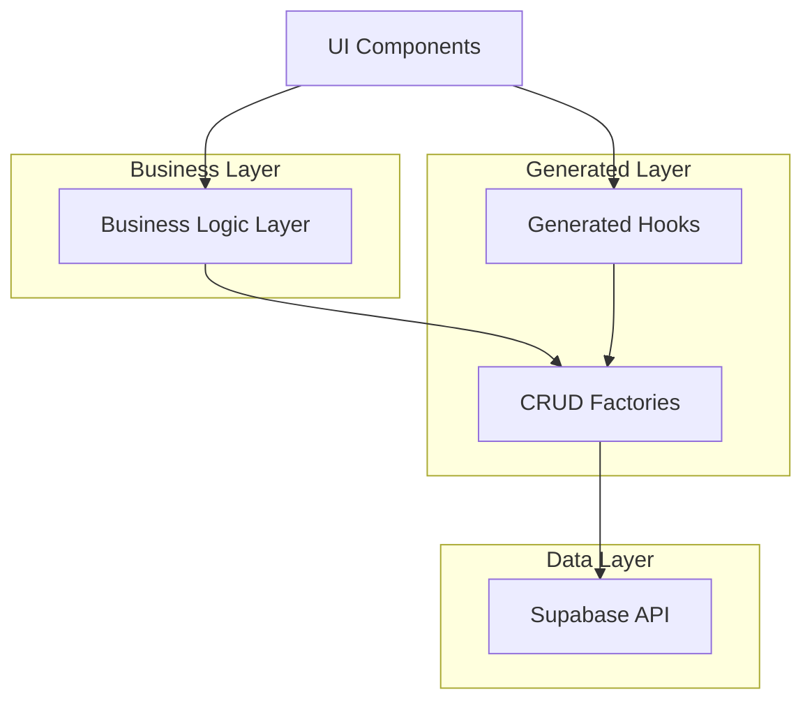

# Design Document: Advanced Refactoring

## Overview

This design implements an advanced refactoring system for a WhatsApp Business CRM React/TypeScript application. The system eliminates code duplication through generic factories, consolidates business logic, and establishes consistent patterns across the codebase.

The design focuses on five core areas:
1. **Generic CRUD Operations** - Factory functions that generate type-safe create, update, delete operations
2. **Query Hook Factory** - Automated generation of TanStack Query hooks for any Supabase table
3. **Unified Form Dialog System** - Single, adaptable dialog component for all entity forms
4. **Centralized Business Logic** - Consolidated layer for complex operations like sale creation
5. **Pattern Consistency** - Standardized approaches for modals, errors, and API interactions

## Architecture

The refactored system follows a layered architecture with clear separation of concerns:



### Core Principles

1. **Generic Programming**: Use TypeScript generics to create reusable, type-safe abstractions
2. **Factory Pattern**: Generate consistent implementations through factory functions
3. **Composition over Inheritance**: Build complex functionality by composing simple, focused functions
4. **Single Responsibility**: Each factory and hook has one clear purpose
5. **Type Safety**: Maintain full TypeScript support throughout all abstractions

## Components and Interfaces

### CRUD Factory System

The CRUD factory generates type-safe mutation hooks for any entity:

```typescript
interface CRUDFactory<T extends Record<string, any>> {
  createEntity: (data: Omit<T, 'id' | 'created_at' | 'updated_at'>) => Promise<T>
  updateEntity: (id: string, data: Partial<T>) => Promise<T>
  deleteEntity: (id: string) => Promise<void>
}

interface CRUDOptions {
  tableName: string
  onSuccess?: (operation: 'create' | 'update' | 'delete', data?: any) => void
  onError?: (error: Error, operation: string) => void
  optimisticUpdates?: boolean
}

function createCRUDFactory<T>(options: CRUDOptions): CRUDFactory<T>
```

### Query Hook Factory

The query factory generates standardized data fetching hooks:

```typescript
interface QueryHookFactory<T> {
  useEntities: (filters?: QueryFilters) => UseQueryResult<T[]>
  useEntity: (id: string) => UseQueryResult<T>
  useEntitiesInfinite: (filters?: QueryFilters) => UseInfiniteQueryResult<T[]>
}

interface QueryOptions {
  tableName: string
  defaultFilters?: QueryFilters
  realTimeSubscription?: boolean
  cacheTime?: number
}

function createQueryFactory<T>(options: QueryOptions): QueryHookFactory<T>
```

### Unified Form Dialog System

A single dialog component that adapts to different entity types:

```typescript
interface FormDialogProps<T> {
  entityType: string
  isOpen: boolean
  onClose: () => void
  initialData?: Partial<T>
  mode: 'create' | 'edit'
  customFields?: FormFieldConfig[]
  onSubmit?: (data: T) => void
}

interface FormFieldConfig {
  name: string
  type: 'text' | 'email' | 'select' | 'textarea' | 'date'
  label: string
  required?: boolean
  validation?: (value: any) => string | undefined
  options?: { label: string; value: any }[]
}

function UnifiedFormDialog<T>(props: FormDialogProps<T>): JSX.Element
```

### Business Logic Layer

Centralized business operations with clear interfaces:

```typescript
interface BusinessLogicLayer {
  saleOperations: SaleOperations
  customerOperations: CustomerOperations
  leadOperations: LeadOperations
}

interface SaleOperations {
  createSale: (saleData: CreateSaleRequest) => Promise<Sale>
  convertLeadToSale: (leadId: string, saleData: Partial<Sale>) => Promise<Sale>
  createQuickSale: (quickSaleData: QuickSaleRequest) => Promise<Sale>
}

interface CreateSaleRequest {
  customerId?: string
  leadId?: string
  products: SaleProduct[]
  paymentMethod: PaymentMethod
  notes?: string
}
```

### Pattern Consistency System

Standardized patterns for common operations:

```typescript
interface ModalManager {
  useModal: (modalId: string) => ModalState
  openModal: (modalId: string, data?: any) => void
  closeModal: (modalId: string) => void
}

interface ErrorHandler {
  handleError: (error: Error, context: string) => void
  showErrorToast: (message: string) => void
  logError: (error: Error, metadata: Record<string, any>) => void
}

interface APIPatterns {
  withLoading: <T>(operation: () => Promise<T>) => Promise<T>
  withErrorHandling: <T>(operation: () => Promise<T>, context: string) => Promise<T>
  withOptimisticUpdate: <T>(operation: () => Promise<T>, optimisticData: T) => Promise<T>
}
```

## Data Models

### Entity Schema Types

The system works with existing Supabase table schemas:

```typescript
interface BaseEntity {
  id: string
  created_at: string
  updated_at: string
}

interface Customer extends BaseEntity {
  name: string
  email?: string
  phone?: string
  company?: string
  notes?: string
}

interface Lead extends BaseEntity {
  name: string
  email?: string
  phone?: string
  source: string
  status: LeadStatus
  notes?: string
}

interface Sale extends BaseEntity {
  customer_id?: string
  lead_id?: string
  total_amount: number
  payment_method: PaymentMethod
  status: SaleStatus
  notes?: string
}
```

### Factory Configuration Types

Configuration objects for factory generation:

```typescript
interface EntityConfig {
  tableName: string
  displayName: string
  fields: FieldConfig[]
  businessLogic?: BusinessLogicConfig
}

interface FieldConfig {
  name: string
  type: FieldType
  label: string
  required: boolean
  validation?: ValidationRule[]
}

interface BusinessLogicConfig {
  onCreate?: (data: any) => Promise<void>
  onUpdate?: (id: string, data: any) => Promise<void>
  onDelete?: (id: string) => Promise<void>
}
```

## Correctness Properties

*A property is a characteristic or behavior that should hold true across all valid executions of a system—essentially, a formal statement about what the system should do. Properties serve as the bridge between human-readable specifications and machine-verifiable correctness guarantees.*

### Property 1: CRUD Factory Consistency
*For any* entity type, when creating a CRUD factory, the generated create, update, and delete functions should have identical behavior patterns and interfaces
**Validates: Requirements 1.1**

### Property 2: CRUD Success Side Effects
*For any* successful CRUD operation, the system should invalidate relevant queries and show success notifications consistently
**Validates: Requirements 1.3**

### Property 3: CRUD Error Handling Consistency
*For any* CRUD operation that fails, the system should handle errors consistently and display appropriate error messages regardless of entity type
**Validates: Requirements 1.4**

### Property 4: Optimistic Updates Round Trip
*For any* CRUD operation with optimistic updates enabled, the optimistic data should be applied immediately and then reconciled correctly with the server response
**Validates: Requirements 1.5**

### Property 5: Backward Compatibility Preservation
*For any* existing mutation hook API call, the behavior should remain identical after refactoring to use CRUD factories
**Validates: Requirements 1.6**

### Property 6: Query Hook Pattern Consistency
*For any* Supabase table, when generating query hooks, the resulting hooks should follow consistent patterns for fetching, filtering, and pagination
**Validates: Requirements 2.1**

### Property 7: Query Error Handling Consistency
*For any* query operation that encounters errors, all generated query hooks should handle them consistently
**Validates: Requirements 2.3**

### Property 8: Query Feature Completeness
*For any* generated query hook, it should support filtering, sorting, and real-time subscriptions as standard features
**Validates: Requirements 2.4**

### Property 9: Query Functionality Preservation
*For any* existing query hook behavior, the functionality should be preserved after migrating to factory-generated hooks
**Validates: Requirements 2.5**

### Property 10: TanStack Query Integration
*For any* generated query hook, it should integrate seamlessly with TanStack Query caching and invalidation mechanisms
**Validates: Requirements 2.6**

### Property 11: Form Dialog Adaptability
*For any* entity type, the unified form dialog should adapt correctly to display appropriate fields and validation
**Validates: Requirements 3.1**

### Property 12: Dynamic Form Generation
*For any* entity schema, the form dialog should dynamically generate appropriate input components based on field types and constraints
**Validates: Requirements 3.2**

### Property 13: Form Validation Consistency
*For any* form validation scenario, the validation rules and error display patterns should be consistent across all entity types
**Validates: Requirements 3.3**

### Property 14: Form CRUD Integration
*For any* form submission (create or update), the form dialog should properly trigger the appropriate CRUD operations
**Validates: Requirements 3.4**

### Property 15: Form Customization Compatibility
*For any* entity-specific customization, the form dialog should support it while maintaining the core unified structure
**Validates: Requirements 3.5**

### Property 16: Form Experience Preservation
*For any* existing form dialog functionality, the user experience should be preserved after migrating to the unified system
**Validates: Requirements 3.6**

### Property 17: Sale Creation Unification
*For any* sale creation scenario (quick sale, customer sale, lead conversion), the business logic layer should handle it through a single, reusable function
**Validates: Requirements 4.1**

### Property 18: Business Operation Atomicity
*For any* business logic execution involving multiple operations, either all operations should succeed or all should fail together (atomicity)
**Validates: Requirements 4.2**

### Property 19: Business Error Recovery
*For any* business operation failure, the system should provide detailed error information and successfully rollback any partial changes
**Validates: Requirements 4.3**

### Property 20: Business Context Unification
*For any* sale creation context (quick sale, customer sale, lead conversion), the operation should work through the unified business logic interface
**Validates: Requirements 4.4**

### Property 21: Business Logic Preservation
*For any* existing business logic behavior, the functionality should be maintained after consolidating into the centralized business logic layer
**Validates: Requirements 4.5**

### Property 22: Modal Pattern Standardization
*For any* modal component, it should use the standardized hooks and patterns for state management, opening, closing, and data passing
**Validates: Requirements 5.1**

### Property 23: Error Pattern Consistency
*For any* error that occurs in the system, it should be handled consistently with standardized display, logging, and user feedback patterns
**Validates: Requirements 5.2**

### Property 24: API Pattern Standardization
*For any* API call made in the system, it should follow consistent patterns for request/response handling, loading states, and error recovery
**Validates: Requirements 5.3**

### Property 25: Pattern Migration Preservation
*For any* component refactored to use standardized patterns, the original functionality should be preserved while adopting the new patterns
**Validates: Requirements 5.5**

### Property 26: Schema Type Accuracy
*For any* Supabase table schema, the automatically generated TypeScript types should accurately reflect the database schema structure
**Validates: Requirements 6.2**

### Property 27: API Type Validation
*For any* API call, the request and response data should be properly typed and validated according to the expected schemas
**Validates: Requirements 6.3**

### Property 28: Factory Performance Parity
*For any* operation performed by factory-generated code, the performance should be equivalent to or better than hand-written implementations
**Validates: Requirements 7.1**

### Property 29: UI Performance Optimization
*For any* form or dialog rendering, the system should optimize re-renders and maintain responsive user interactions
**Validates: Requirements 7.2**

### Property 30: Cache Efficiency
*For any* query cache operation, the system should efficiently invalidate and update cached data without causing unnecessary network requests
**Validates: Requirements 7.3**

### Property 31: Large Dataset Performance
*For any* operation on large datasets, the system should maintain current pagination and virtualization performance levels
**Validates: Requirements 7.5**

### Property 32: Performance Monitoring Accuracy
*For any* critical operation, the performance monitoring hooks should accurately measure and report performance metrics
**Validates: Requirements 7.6**

## Error Handling

The refactored system implements comprehensive error handling at multiple levels:

### Factory-Level Error Handling
- **CRUD Factories**: Standardized error catching, logging, and user notification
- **Query Factories**: Consistent error states and retry mechanisms
- **Form Factories**: Validation error display and recovery

### Business Logic Error Handling
- **Atomic Operations**: Rollback mechanisms for multi-step operations
- **Error Context**: Detailed error information with operation context
- **Recovery Strategies**: Automatic retry for transient errors

### Pattern-Level Error Handling
- **Standardized Error Types**: Consistent error classification and handling
- **User Feedback**: Toast notifications and inline error messages
- **Error Boundaries**: React error boundaries for graceful degradation

### Error Monitoring
- **Centralized Logging**: All errors logged with context and stack traces
- **Performance Impact**: Error handling optimized to minimize performance overhead
- **User Experience**: Errors presented in user-friendly language with actionable guidance

## Testing Strategy

The advanced refactoring system requires comprehensive testing to ensure reliability and maintainability:

### Property-Based Testing
Property-based tests validate universal correctness properties across all generated code:

- **Factory Generation**: Test that factories generate consistent, type-safe operations for any entity
- **Business Logic**: Verify atomic operations and error recovery across all scenarios
- **Form Systems**: Validate dynamic form generation and validation for any schema
- **Performance**: Ensure factory-generated code maintains performance parity

Each property test should run a minimum of 100 iterations and be tagged with:
**Feature: advanced-refactoring, Property {number}: {property_text}**

### Unit Testing
Unit tests focus on specific examples, edge cases, and integration points:

- **Factory Configuration**: Test factory creation with various configuration options
- **Error Scenarios**: Test specific error conditions and recovery mechanisms
- **Integration Points**: Test interaction between factories, business logic, and UI components
- **Migration Compatibility**: Test that refactored code maintains existing API contracts

### Integration Testing
Integration tests verify the system works correctly as a whole:

- **End-to-End Workflows**: Test complete user workflows using refactored components
- **Cross-Factory Integration**: Test interaction between different factory-generated hooks
- **Business Process Testing**: Test complex business operations like sale creation
- **Performance Benchmarking**: Compare performance before and after refactoring

### Testing Configuration
- **Property-Based Testing Library**: Use `fast-check` for TypeScript property-based testing
- **Test Iterations**: Minimum 100 iterations per property test for thorough coverage
- **Mock Strategy**: Mock Supabase client for isolated testing of business logic
- **Performance Testing**: Use React Testing Library with performance monitoring hooks