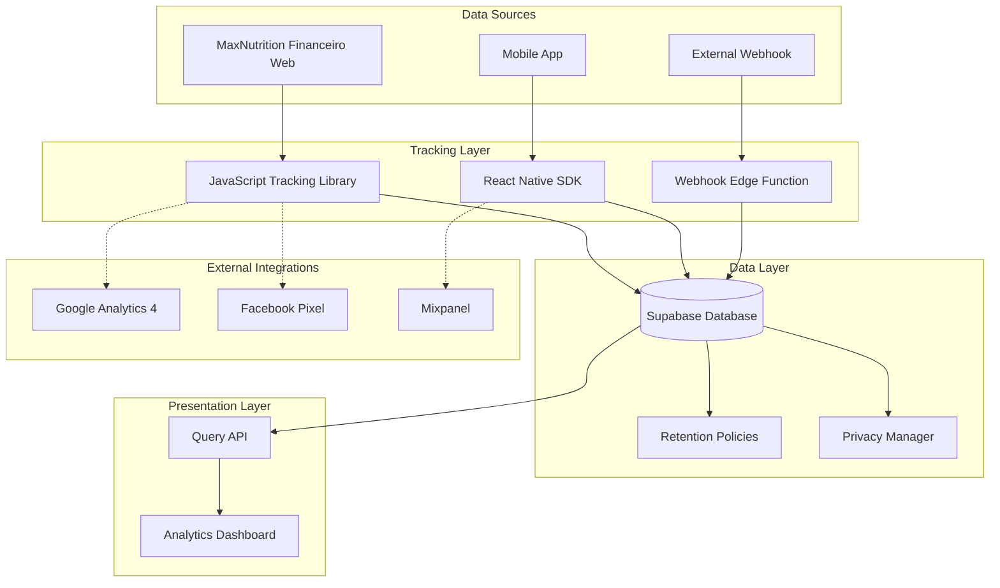

# Design Document: Analytics and Tracking System

## Overview

The Analytics and Tracking System is a comprehensive data collection and analysis platform that monitors user behavior, AI costs, conversions, and financial metrics across the MaxNutrition Financeiro web application and mobile app. The system consists of:

1. **Client-side tracking libraries** (JavaScript for web, React Native SDK for mobile)
2. **Webhook endpoint** for receiving external data from app.oficialmaxnutrition.com.br
3. **Supabase database** with optimized schema and indexes
4. **Analytics dashboard** built with React/TypeScript and Recharts
5. **Privacy management layer** ensuring GDPR/LGPD compliance

The architecture follows a hub-and-spoke model where all tracking data flows into a centralized Supabase database, enabling unified analytics and cross-platform insights.

## Architecture

### System Components



### Data Flow

1. **Website Tracking**: JavaScript library captures events → sends to Supabase REST API → stored in database
2. **App Tracking**: React Native SDK captures events → batches locally → sends to Supabase REST API → stored in database
3. **Webhook Data**: External system sends POST → Edge Function validates → parses and stores in database
4. **Dashboard Queries**: React app → Supabase client → executes optimized queries → renders visualizations
5. **Privacy Operations**: User request → Privacy Manager → executes data export/deletion → returns confirmation

### Technology Stack

- **Database**: Supabase (PostgreSQL) with Row Level Security
- **Edge Functions**: Supabase Edge Functions (Deno runtime) for webhook processing
- **Frontend**: React 18 + TypeScript + Vite
- **Visualization**: Recharts for charts and graphs
- **Tracking**: Custom JavaScript library (vanilla JS) and React Native SDK
- **State Management**: TanStack Query for server state
- **Styling**: Tailwind CSS + shadcn/ui components

## Components and Interfaces

### 1. Database Schema

#### visitors Table
```sql
CREATE TABLE visitors (
  visitor_id UUID PRIMARY KEY DEFAULT gen_random_uuid(),
  session_id UUID NOT NULL,
  user_agent TEXT,
  ip_address_anonymized INET,
  country VARCHAR(2),
  city VARCHAR(100),
  device_type VARCHAR(50),
  browser VARCHAR(50),
  browser_version VARCHAR(20),
  os VARCHAR(50),
  os_version VARCHAR(20),
  first_seen_at TIMESTAMPTZ NOT NULL DEFAULT NOW(),
  last_seen_at TIMESTAMPTZ NOT NULL DEFAULT NOW(),
  created_at TIMESTAMPTZ NOT NULL DEFAULT NOW()
);

CREATE INDEX idx_visitors_session ON visitors(session_id);
CREATE INDEX idx_visitors_first_seen ON visitors(first_seen_at);
CREATE INDEX idx_visitors_last_seen ON visitors(last_seen_at);
```

#### page_views Table
```sql
CREATE TABLE page_views (
  id UUID PRIMARY KEY DEFAULT gen_random_uuid(),
  visitor_id UUID REFERENCES visitors(visitor_id) ON DELETE CASCADE,
  session_id UUID NOT NULL,
  user_id UUID REFERENCES auth.users(id) ON DELETE SET NULL,
  url TEXT NOT NULL,
  page_title TEXT,
  referrer TEXT,
  time_on_page_seconds INTEGER,
  scroll_depth_percent INTEGER CHECK (scroll_depth_percent >= 0 AND scroll_depth_percent <= 100),
  viewed_at TIMESTAMPTZ NOT NULL DEFAULT NOW(),
  created_at TIMESTAMPTZ NOT NULL DEFAULT NOW()
);

CREATE INDEX idx_page_views_visitor ON page_views(visitor_id);
CREATE INDEX idx_page_views_session ON page_views(session_id);
CREATE INDEX idx_page_views_user ON page_views(user_id);
CREATE INDEX idx_page_views_viewed_at ON page_views(viewed_at);
CREATE INDEX idx_page_views_url ON page_views(url);
```

#### interactions Table
```sql
CREATE TABLE interactions (
  id UUID PRIMARY KEY DEFAULT gen_random_uuid(),
  visitor_id UUID REFERENCES visitors(visitor_id) ON DELETE CASCADE,
  session_id UUID NOT NULL,
  user_id UUID REFERENCES auth.users(id) ON DELETE SET NULL,
  page_url TEXT NOT NULL,
  element_type VARCHAR(50) NOT NULL,
  element_selector TEXT,
  element_text TEXT,
  position_x INTEGER,
  position_y INTEGER,
  context JSONB,
  interacted_at TIMESTAMPTZ NOT NULL DEFAULT NOW(),
  created_at TIMESTAMPTZ NOT NULL DEFAULT NOW()
);

CREATE INDEX idx_interactions_visitor ON interactions(visitor_id);
CREATE INDEX idx_interactions_session ON interactions(session_id);
CREATE INDEX idx_interactions_user ON interactions(user_id);
CREATE INDEX idx_interactions_interacted_at ON interactions(interacted_at);
CREATE INDEX idx_interactions_element_type ON interactions(element_type);
```

#### form_interactions Table
```sql
CREATE TABLE form_interactions (
  id UUID PRIMARY KEY DEFAULT gen_random_uuid(),
  visitor_id UUID REFERENCES visitors(visitor_id) ON DELETE CASCADE,
  session_id UUID NOT NULL,
  user_id UUID REFERENCES auth.users(id) ON DELETE SET NULL,
  form_id VARCHAR(100) NOT NULL,
  field_name VARCHAR(100),
  event_type VARCHAR(20) NOT NULL CHECK (event_type IN ('focus', 'blur', 'submit', 'abandon')),
  completion_time_seconds INTEGER,
  fields_filled_count INTEGER,
  abandonment_point VARCHAR(100),
  occurred_at TIMESTAMPTZ NOT NULL DEFAULT NOW(),
  created_at TIMESTAMPTZ NOT NULL DEFAULT NOW()
);

CREATE INDEX idx_form_interactions_visitor ON form_interactions(visitor_id);
CREATE INDEX idx_form_interactions_session ON form_interactions(session_id);
CREATE INDEX idx_form_interactions_form_id ON form_interactions(form_id);
CREATE INDEX idx_form_interactions_event_type ON form_interactions(event_type);
CREATE INDEX idx_form_interactions_occurred_at ON form_interactions(occurred_at);
```

#### users_analytics Table
```sql
CREATE TABLE users_analytics (
  user_id UUID PRIMARY KEY REFERENCES auth.users(id) ON DELETE CASCADE,
  email TEXT NOT NULL,
  signup_date TIMESTAMPTZ NOT NULL,
  subscription_tier VARCHAR(50),
  subscription_status VARCHAR(20) CHECK (subscription_status IN ('active', 'inactive', 'churned', 'trial')),
  last_activity_at TIMESTAMPTZ,
  created_at TIMESTAMPTZ NOT NULL DEFAULT NOW(),
  updated_at TIMESTAMPTZ NOT NULL DEFAULT NOW()
);

CREATE INDEX idx_users_analytics_subscription_tier ON users_analytics(subscription_tier);
CREATE INDEX idx_users_analytics_subscription_status ON users_analytics(subscription_status);
CREATE INDEX idx_users_analytics_signup_date ON users_analytics(signup_date);
```

#### app_sessions Table
```sql
CREATE TABLE app_sessions (
  id UUID PRIMARY KEY DEFAULT gen_random_uuid(),
  session_id UUID NOT NULL UNIQUE,
  user_id UUID REFERENCES auth.users(id) ON DELETE CASCADE,
  device_id VARCHAR(255),
  platform VARCHAR(20) CHECK (platform IN ('ios', 'android')),
  app_version VARCHAR(20),
  os_version VARCHAR(20),
  device_model VARCHAR(100),
  session_duration_seconds INTEGER,
  screens_viewed_count INTEGER DEFAULT 0,
  actions_count INTEGER DEFAULT 0,
  app_launch_time_ms INTEGER,
  started_at TIMESTAMPTZ NOT NULL DEFAULT NOW(),
  ended_at TIMESTAMPTZ,
  created_at TIMESTAMPTZ NOT NULL DEFAULT NOW()
);

CREATE INDEX idx_app_sessions_user ON app_sessions(user_id);
CREATE INDEX idx_app_sessions_session_id ON app_sessions(session_id);
CREATE INDEX idx_app_sessions_started_at ON app_sessions(started_at);
CREATE INDEX idx_app_sessions_platform ON app_sessions(platform);
```

#### app_events Table
```sql
CREATE TABLE app_events (
  id UUID PRIMARY KEY DEFAULT gen_random_uuid(),
  session_id UUID REFERENCES app_sessions(session_id) ON DELETE CASCADE,
  user_id UUID REFERENCES auth.users(id) ON DELETE CASCADE,
  event_type VARCHAR(50) NOT NULL,
  event_name VARCHAR(100) NOT NULL,
  screen_name VARCHAR(100),
  previous_screen VARCHAR(100),
  properties JSONB,
  occurred_at TIMESTAMPTZ NOT NULL DEFAULT NOW(),
  created_at TIMESTAMPTZ NOT NULL DEFAULT NOW()
);

CREATE INDEX idx_app_events_session ON app_events(session_id);
CREATE INDEX idx_app_events_user ON app_events(user_id);
CREATE INDEX idx_app_events_event_type ON app_events(event_type);
CREATE INDEX idx_app_events_event_name ON app_events(event_name);
CREATE INDEX idx_app_events_occurred_at ON app_events(occurred_at);
```

#### ai_usage Table
```sql
CREATE TABLE ai_usage (
  id UUID PRIMARY KEY DEFAULT gen_random_uuid(),
  user_id UUID REFERENCES auth.users(id) ON DELETE CASCADE,
  provider VARCHAR(50) NOT NULL,
  model_name VARCHAR(100) NOT NULL,
  feature_name VARCHAR(100) NOT NULL,
  token_count INTEGER NOT NULL,
  cost_usd DECIMAL(10, 6) NOT NULL,
  response_time_ms INTEGER,
  success BOOLEAN NOT NULL DEFAULT true,
  error_message TEXT,
  used_at TIMESTAMPTZ NOT NULL DEFAULT NOW(),
  created_at TIMESTAMPTZ NOT NULL DEFAULT NOW()
);

CREATE INDEX idx_ai_usage_user ON ai_usage(user_id);
CREATE INDEX idx_ai_usage_provider ON ai_usage(provider);
CREATE INDEX idx_ai_usage_model ON ai_usage(model_name);
CREATE INDEX idx_ai_usage_feature ON ai_usage(feature_name);
CREATE INDEX idx_ai_usage_used_at ON ai_usage(used_at);
```

#### conversions Table
```sql
CREATE TABLE conversions (
  id UUID PRIMARY KEY DEFAULT gen_random_uuid(),
  visitor_id UUID REFERENCES visitors(visitor_id) ON DELETE SET NULL,
  user_id UUID REFERENCES auth.users(id) ON DELETE CASCADE,
  conversion_type VARCHAR(50) NOT NULL CHECK (conversion_type IN ('download', 'install', 'activation', 'subscription')),
  platform VARCHAR(20),
  store VARCHAR(50),
  source VARCHAR(100),
  campaign VARCHAR(100),
  utm_source VARCHAR(100),
  utm_medium VARCHAR(100),
  utm_campaign VARCHAR(100),
  utm_term VARCHAR(100),
  utm_content VARCHAR(100),
  plan_name VARCHAR(100),
  billing_cycle VARCHAR(20),
  price_usd DECIMAL(10, 2),
  trial_start_date DATE,
  trial_end_date DATE,
  converted_at TIMESTAMPTZ NOT NULL DEFAULT NOW(),
  created_at TIMESTAMPTZ NOT NULL DEFAULT NOW()
);

CREATE INDEX idx_conversions_visitor ON conversions(visitor_id);
CREATE INDEX idx_conversions_user ON conversions(user_id);
CREATE INDEX idx_conversions_type ON conversions(conversion_type);
CREATE INDEX idx_conversions_converted_at ON conversions(converted_at);
CREATE INDEX idx_conversions_campaign ON conversions(campaign);
```

#### transactions Table
```sql
CREATE TABLE transactions (
  id UUID PRIMARY KEY DEFAULT gen_random_uuid(),
  user_id UUID REFERENCES auth.users(id) ON DELETE CASCADE,
  transaction_type VARCHAR(50) NOT NULL CHECK (transaction_type IN ('subscription', 'purchase', 'refund')),
  amount_usd DECIMAL(10, 2) NOT NULL,
  currency VARCHAR(3) NOT NULL DEFAULT 'USD',
  payment_method VARCHAR(50),
  status VARCHAR(20) NOT NULL CHECK (status IN ('pending', 'completed', 'failed', 'refunded')),
  transaction_date TIMESTAMPTZ NOT NULL DEFAULT NOW(),
  created_at TIMESTAMPTZ NOT NULL DEFAULT NOW()
);

CREATE INDEX idx_transactions_user ON transactions(user_id);
CREATE INDEX idx_transactions_type ON transactions(transaction_type);
CREATE INDEX idx_transactions_status ON transactions(status);
CREATE INDEX idx_transactions_date ON transactions(transaction_date);
```

#### marketing_attribution Table
```sql
CREATE TABLE marketing_attribution (
  id UUID PRIMARY KEY DEFAULT gen_random_uuid(),
  visitor_id UUID REFERENCES visitors(visitor_id) ON DELETE CASCADE,
  user_id UUID REFERENCES auth.users(id) ON DELETE SET NULL,
  utm_source VARCHAR(100),
  utm_medium VARCHAR(100),
  utm_campaign VARCHAR(100),
  utm_term VARCHAR(100),
  utm_content VARCHAR(100),
  referrer TEXT,
  landing_page TEXT,
  attributed_at TIMESTAMPTZ NOT NULL DEFAULT NOW(),
  created_at TIMESTAMPTZ NOT NULL DEFAULT NOW()
);

CREATE INDEX idx_marketing_attribution_visitor ON marketing_attribution(visitor_id);
CREATE INDEX idx_marketing_attribution_user ON marketing_attribution(user_id);
CREATE INDEX idx_marketing_attribution_campaign ON marketing_attribution(utm_campaign);
CREATE INDEX idx_marketing_attribution_source ON marketing_attribution(utm_source);
CREATE INDEX idx_marketing_attribution_attributed_at ON marketing_attribution(attributed_at);
```

#### retention_cohorts Table
```sql
CREATE TABLE retention_cohorts (
  id UUID PRIMARY KEY DEFAULT gen_random_uuid(),
  user_id UUID REFERENCES auth.users(id) ON DELETE CASCADE,
  cohort_month DATE NOT NULL,
  active_day_7 BOOLEAN DEFAULT false,
  active_day_30 BOOLEAN DEFAULT false,
  active_day_90 BOOLEAN DEFAULT false,
  churn_date DATE,
  churn_reason TEXT,
  churn_risk_score INTEGER CHECK (churn_risk_score >= 0 AND churn_risk_score <= 100),
  retention_attempts INTEGER DEFAULT 0,
  created_at TIMESTAMPTZ NOT NULL DEFAULT NOW(),
  updated_at TIMESTAMPTZ NOT NULL DEFAULT NOW()
);

CREATE INDEX idx_retention_cohorts_user ON retention_cohorts(user_id);
CREATE INDEX idx_retention_cohorts_month ON retention_cohorts(cohort_month);
CREATE INDEX idx_retention_cohorts_churn_date ON retention_cohorts(churn_date);
```

#### privacy_requests Table
```sql
CREATE TABLE privacy_requests (
  id UUID PRIMARY KEY DEFAULT gen_random_uuid(),
  user_id UUID REFERENCES auth.users(id) ON DELETE CASCADE,
  request_type VARCHAR(20) NOT NULL CHECK (request_type IN ('export', 'delete')),
  status VARCHAR(20) NOT NULL CHECK (status IN ('pending', 'processing', 'completed', 'failed')),
  requested_at TIMESTAMPTZ NOT NULL DEFAULT NOW(),
  completed_at TIMESTAMPTZ,
  created_at TIMESTAMPTZ NOT NULL DEFAULT NOW()
);

CREATE INDEX idx_privacy_requests_user ON privacy_requests(user_id);
CREATE INDEX idx_privacy_requests_status ON privacy_requests(status);
CREATE INDEX idx_privacy_requests_requested_at ON privacy_requests(requested_at);
```

### 2. JavaScript Tracking Library

#### Interface
```typescript
interface AnalyticsConfig {
  projectId: string;
  apiUrl: string;
  apiKey: string;
  autoTrackPageViews?: boolean;
  trackScrollDepth?: boolean;
  trackClicks?: boolean;
  sessionTimeout?: number; // minutes
}

interface EventProperties {
  [key: string]: string | number | boolean | null;
}

interface UserProperties {
  email?: string;
  name?: string;
  [key: string]: string | number | boolean | null | undefined;
}

class Analytics {
  init(config: AnalyticsConfig): void;
  trackPageView(url?: string, title?: string): void;
  trackEvent(eventName: string, properties?: EventProperties): void;
  identify(userId: string, properties?: UserProperties): void;
  setVisitorId(visitorId: string): void;
  getVisitorId(): string | null;
  getSessionId(): string | null;
}
```

#### Implementation Strategy
- Use localStorage to persist visitor_id and session_id
- Implement session timeout (30 minutes of inactivity)
- Batch events and send every 5 seconds or when 10 events accumulate
- Use sendBeacon API for reliable event delivery on page unload
- Automatically capture user_agent, screen resolution, and referrer
- Implement IP anonymization on the server side
- Add retry logic with exponential backoff for failed requests

### 3. React Native SDK

#### Interface
```typescript
interface SDKConfig {
  projectId: string;
  apiUrl: string;
  apiKey: string;
  batchSize?: number;
  batchInterval?: number; // seconds
}

interface ScreenProperties {
  [key: string]: string | number | boolean | null;
}

class AnalyticsSDK {
  static initialize(config: SDKConfig): Promise<void>;
  static trackScreen(screenName: string, properties?: ScreenProperties): void;
  static trackEvent(eventName: string, properties?: EventProperties): void;
  static identify(userId: string, properties?: UserProperties): void;
  static setDeviceId(deviceId: string): void;
  static flush(): Promise<void>;
}
```

#### Implementation Strategy
- Use AsyncStorage to persist device_id and session_id
- Automatically track app lifecycle events (open, background, close)
- Batch events locally and send every 30 seconds or when 20 events accumulate
- Implement offline queue with persistence
- Capture device info using react-native-device-info
- Track app performance metrics (launch time, screen load time)
- Implement retry logic with exponential backoff

### 4. Webhook Edge Function

#### Endpoint
```
POST /functions/v1/analytics-webhook
```

#### Request Format
```typescript
interface WebhookPayload {
  signature: string;
  timestamp: number;
  event_type: string;
  user_id?: string;
  properties: Record<string, any>;
}
```

#### Response Format
```typescript
interface WebhookResponse {
  success: boolean;
  message: string;
  event_id?: string;
}
```

#### Implementation
```typescript
import { serve } from "https://deno.land/std@0.168.0/http/server.ts";
import { createClient } from "https://esm.sh/@supabase/supabase-js@2";

const WEBHOOK_SECRET = Deno.env.get("WEBHOOK_SECRET")!;

serve(async (req) => {
  // Validate request method
  if (req.method !== "POST") {
    return new Response(JSON.stringify({ success: false, message: "Method not allowed" }), {
      status: 405,
      headers: { "Content-Type": "application/json" },
    });
  }

  try {
    // Parse payload
    const payload: WebhookPayload = await req.json();

    // Validate signature
    const expectedSignature = await generateSignature(payload, WEBHOOK_SECRET);
    if (payload.signature !== expectedSignature) {
      return new Response(JSON.stringify({ success: false, message: "Invalid signature" }), {
        status: 401,
        headers: { "Content-Type": "application/json" },
      });
    }

    // Validate timestamp (prevent replay attacks)
    const now = Date.now();
    if (Math.abs(now - payload.timestamp) > 300000) { // 5 minutes
      return new Response(JSON.stringify({ success: false, message: "Timestamp too old" }), {
        status: 401,
        headers: { "Content-Type": "application/json" },
      });
    }

    // Initialize Supabase client
    const supabase = createClient(
      Deno.env.get("SUPABASE_URL")!,
      Deno.env.get("SUPABASE_SERVICE_ROLE_KEY")!
    );

    // Route event to appropriate table
    const eventId = await processEvent(supabase, payload);

    return new Response(
      JSON.stringify({ success: true, message: "Event processed", event_id: eventId }),
      { status: 200, headers: { "Content-Type": "application/json" } }
    );
  } catch (error) {
    console.error("Webhook processing error:", error);
    return new Response(
      JSON.stringify({ success: false, message: "Internal server error" }),
      { status: 500, headers: { "Content-Type": "application/json" } }
    );
  }
});

async function generateSignature(payload: WebhookPayload, secret: string): Promise<string> {
  const data = JSON.stringify({ ...payload, signature: undefined });
  const encoder = new TextEncoder();
  const keyData = encoder.encode(secret);
  const messageData = encoder.encode(data);
  
  const key = await crypto.subtle.importKey(
    "raw",
    keyData,
    { name: "HMAC", hash: "SHA-256" },
    false,
    ["sign"]
  );
  
  const signature = await crypto.subtle.sign("HMAC", key, messageData);
  return Array.from(new Uint8Array(signature))
    .map(b => b.toString(16).padStart(2, "0"))
    .join("");
}

async function processEvent(supabase: any, payload: WebhookPayload): Promise<string> {
  // Route based on event_type
  switch (payload.event_type) {
    case "app_event":
      return await insertAppEvent(supabase, payload);
    case "ai_usage":
      return await insertAIUsage(supabase, payload);
    case "transaction":
      return await insertTransaction(supabase, payload);
    default:
      throw new Error(`Unknown event type: ${payload.event_type}`);
  }
}
```

### 5. Analytics Dashboard

#### Component Structure
```
src/
├── components/
│   ├── dashboard/
│   │   ├── KPICard.tsx
│   │   ├── VisitorsChart.tsx
│   │   ├── AIUsageChart.tsx
│   │   ├── RevenueChart.tsx
│   │   ├── TopPagesTable.tsx
│   │   ├── TopUsersTable.tsx
│   │   ├── RecentDownloadsTable.tsx
│   │   └── TimeRangeFilter.tsx
│   └── privacy/
│       ├── DataExportDialog.tsx
│       └── DataDeletionDialog.tsx
├── hooks/
│   ├── useAnalytics.ts
│   ├── useKPIs.ts
│   └── usePrivacyRequests.ts
├── lib/
│   ├── supabase.ts
│   └── analytics-queries.ts
└── pages/
    ├── Dashboard.tsx
    └── Privacy.tsx
```

#### Key Queries
```typescript
// Get visitors by day
export async function getVisitorsByDay(startDate: Date, endDate: Date) {
  const { data, error } = await supabase
    .from('visitors')
    .select('first_seen_at')
    .gte('first_seen_at', startDate.toISOString())
    .lte('first_seen_at', endDate.toISOString());
  
  // Group by day
  const grouped = data?.reduce((acc, visitor) => {
    const day = new Date(visitor.first_seen_at).toISOString().split('T')[0];
    acc[day] = (acc[day] || 0) + 1;
    return acc;
  }, {} as Record<string, number>);
  
  return grouped;
}

// Get AI costs by feature
export async function getAICostsByFeature(startDate: Date, endDate: Date) {
  const { data, error } = await supabase
    .from('ai_usage')
    .select('feature_name, cost_usd')
    .gte('used_at', startDate.toISOString())
    .lte('used_at', endDate.toISOString());
  
  // Group by feature
  const grouped = data?.reduce((acc, usage) => {
    acc[usage.feature_name] = (acc[usage.feature_name] || 0) + Number(usage.cost_usd);
    return acc;
  }, {} as Record<string, number>);
  
  return grouped;
}

// Get conversion funnel
export async function getConversionFunnel(startDate: Date, endDate: Date) {
  const visitors = await supabase
    .from('visitors')
    .select('visitor_id', { count: 'exact' })
    .gte('first_seen_at', startDate.toISOString())
    .lte('first_seen_at', endDate.toISOString());
  
  const users = await supabase
    .from('users_analytics')
    .select('user_id', { count: 'exact' })
    .gte('signup_date', startDate.toISOString())
    .lte('signup_date', endDate.toISOString());
  
  const subscribers = await supabase
    .from('users_analytics')
    .select('user_id', { count: 'exact' })
    .eq('subscription_status', 'active')
    .gte('signup_date', startDate.toISOString())
    .lte('signup_date', endDate.toISOString());
  
  return {
    visitors: visitors.count || 0,
    users: users.count || 0,
    subscribers: subscribers.count || 0,
    visitorToUser: users.count / visitors.count,
    userToSubscriber: subscribers.count / users.count,
  };
}
```

### 6. Privacy Manager

#### Interface
```typescript
interface PrivacyManager {
  requestDataExport(userId: string): Promise<string>; // Returns request ID
  requestDataDeletion(userId: string): Promise<string>; // Returns request ID
  anonymizeIP(ipAddress: string): string;
  checkConsent(visitorId: string): Promise<boolean>;
  recordConsent(visitorId: string, consented: boolean): Promise<void>;
}
```

#### Implementation
```typescript
export class PrivacyManagerImpl implements PrivacyManager {
  constructor(private supabase: SupabaseClient) {}

  async requestDataExport(userId: string): Promise<string> {
    const { data, error } = await this.supabase
      .from('privacy_requests')
      .insert({
        user_id: userId,
        request_type: 'export',
        status: 'pending',
      })
      .select('id')
      .single();
    
    if (error) throw error;
    
    // Trigger background job to process export
    await this.triggerExportJob(data.id);
    
    return data.id;
  }

  async requestDataDeletion(userId: string): Promise<string> {
    const { data, error } = await this.supabase
      .from('privacy_requests')
      .insert({
        user_id: userId,
        request_type: 'delete',
        status: 'pending',
      })
      .select('id')
      .single();
    
    if (error) throw error;
    
    // Trigger background job to process deletion
    await this.triggerDeletionJob(data.id);
    
    return data.id;
  }

  anonymizeIP(ipAddress: string): string {
    const parts = ipAddress.split('.');
    if (parts.length === 4) {
      // IPv4: Remove last octet
      return `${parts[0]}.${parts[1]}.${parts[2]}.0`;
    } else {
      // IPv6: Remove last 80 bits
      const ipv6Parts = ipAddress.split(':');
      return ipv6Parts.slice(0, 3).join(':') + '::';
    }
  }

  async checkConsent(visitorId: string): Promise<boolean> {
    // Check localStorage or cookie for consent
    const consent = localStorage.getItem(`consent_${visitorId}`);
    return consent === 'true';
  }

  async recordConsent(visitorId: string, consented: boolean): Promise<void> {
    localStorage.setItem(`consent_${visitorId}`, String(consented));
  }
}
```

## Data Models

### Core Entities

#### Visitor
```typescript
interface Visitor {
  visitor_id: string;
  session_id: string;
  user_agent: string;
  ip_address_anonymized: string;
  country: string;
  city: string;
  device_type: string;
  browser: string;
  browser_version: string;
  os: string;
  os_version: string;
  first_seen_at: Date;
  last_seen_at: Date;
  created_at: Date;
}
```

#### PageView
```typescript
interface PageView {
  id: string;
  visitor_id: string;
  session_id: string;
  user_id?: string;
  url: string;
  page_title: string;
  referrer: string;
  time_on_page_seconds: number;
  scroll_depth_percent: number;
  viewed_at: Date;
  created_at: Date;
}
```

#### AIUsage
```typescript
interface AIUsage {
  id: string;
  user_id: string;
  provider: string;
  model_name: string;
  feature_name: string;
  token_count: number;
  cost_usd: number;
  response_time_ms: number;
  success: boolean;
  error_message?: string;
  used_at: Date;
  created_at: Date;
}
```

#### Conversion
```typescript
interface Conversion {
  id: string;
  visitor_id?: string;
  user_id: string;
  conversion_type: 'download' | 'install' | 'activation' | 'subscription';
  platform?: string;
  store?: string;
  source?: string;
  campaign?: string;
  utm_source?: string;
  utm_medium?: string;
  utm_campaign?: string;
  utm_term?: string;
  utm_content?: string;
  plan_name?: string;
  billing_cycle?: string;
  price_usd?: number;
  trial_start_date?: Date;
  trial_end_date?: Date;
  converted_at: Date;
  created_at: Date;
}
```

### Aggregated Metrics

#### KPIMetrics
```typescript
interface KPIMetrics {
  total_visitors: number;
  active_users: number;
  app_downloads: number;
  total_ai_cost_usd: number;
  total_revenue_usd: number;
  mrr_usd: number;
  arr_usd: number;
  avg_ltv_usd: number;
  cac_usd: number;
  churn_rate: number;
}
```

#### ConversionFunnel
```typescript
interface ConversionFunnel {
  visitors: number;
  users: number;
  subscribers: number;
  visitor_to_user_rate: number;
  user_to_subscriber_rate: number;
  overall_conversion_rate: number;
}
```

#### RetentionCohort
```typescript
interface RetentionCohort {
  cohort_month: string;
  total_users: number;
  active_day_7: number;
  active_day_30: number;
  active_day_90: number;
  retention_rate_7: number;
  retention_rate_30: number;
  retention_rate_90: number;
}
```


## Correctness Properties

*A property is a characteristic or behavior that should hold true across all valid executions of a system—essentially, a formal statement about what the system should do. Properties serve as the bridge between human-readable specifications and machine-verifiable correctness guarantees.*

### Property 1: Visitor ID Uniqueness and Persistence

*For any* visitor session, when a visitor accesses the website for the first time, a unique visitor_id should be generated, and that same visitor_id should persist across all page views within the same browser session.

**Validates: Requirements 1.1**

### Property 2: Session Lifecycle Management

*For any* visitor session, when a visitor starts browsing, a session_id should be created that remains valid during activity, expires after 30 minutes of inactivity, and a new session_id should be created for subsequent activity after expiration.

**Validates: Requirements 1.2, 1.4**

### Property 3: Visitor Metadata Completeness

*For any* tracked visitor, the visitor record should contain non-null values for user_agent, anonymized IP address, geographic location (country, city), device type, browser, and OS information.

**Validates: Requirements 1.3**

### Property 4: Page View Data Completeness

*For any* page view event, the page view record should contain non-null values for URL, page title, referrer, timestamp, session_id, and visitor_id.

**Validates: Requirements 2.1**

### Property 5: Time on Page Accuracy

*For any* page view with a known duration, the recorded time_on_page_seconds should match the actual duration within a tolerance of ±2 seconds.

**Validates: Requirements 2.2**

### Property 6: Scroll Depth Validation

*For any* scroll tracking event, the recorded scroll_depth_percent should be one of the valid increments: 25, 50, 75, or 100.

**Validates: Requirements 2.3**

### Property 7: Session Continuity Across Navigation

*For any* multi-page browsing session, all page views within the same session should share the same session_id until the session expires.

**Validates: Requirements 2.4**

### Property 8: Click Interaction Data Completeness

*For any* tracked click event, the interaction record should contain non-null values for element_type, CSS selector, position coordinates (x, y), page URL, session_id, and visitor_id, and for button/link elements should also capture element text and destination.

**Validates: Requirements 3.1, 3.3**

### Property 9: Click-Session Association

*For any* click interaction, the recorded session_id and page_url should match the current active session and page at the time of the click.

**Validates: Requirements 3.2**

### Property 10: Trackable Element Filtering

*For any* DOM element, click tracking should only occur if the element or one of its ancestors has a data-track attribute.

**Validates: Requirements 3.4**

### Property 11: Form Interaction Event Completeness

*For any* form focus event, the form interaction record should contain non-null values for form_id, field_name, event_type, timestamp, session_id, and visitor_id.

**Validates: Requirements 4.1**

### Property 12: Form Completion Metrics Calculation

*For any* completed form submission, the system should correctly calculate completion_time_seconds (time from first focus to submit) and fields_filled_count (number of fields that received focus).

**Validates: Requirements 4.2**

### Property 13: Form Abandonment Tracking

*For any* form abandonment event (focus without submit), the system should record which fields were filled and the abandonment_point (last field that received focus).

**Validates: Requirements 4.3**

### Property 14: Form Value Privacy Protection

*For any* form interaction record in the database, no actual field values should be stored—only metadata about the interaction (form_id, field_name, event_type, timing).

**Validates: Requirements 4.4**

### Property 15: User Registration Data Completeness

*For any* user registration event, the user_analytics record should contain non-null values for user_id, email, signup_date, and initial subscription_tier.

**Validates: Requirements 5.1**

### Property 16: Subscription Update Propagation

*For any* user subscription change, the user_analytics record should be updated to reflect the new subscription_tier and subscription_status.

**Validates: Requirements 5.2**

### Property 17: Visitor-to-User Linking

*For any* visitor who authenticates as a user, all subsequent tracking events should link the visitor_id to the user_id, enabling cross-session user journey analysis.

**Validates: Requirements 5.3**

### Property 18: User Status Validation

*For any* user_analytics record, the subscription_status field should contain only valid values: 'active', 'inactive', 'churned', or 'trial'.

**Validates: Requirements 5.4**

### Property 19: Webhook Signature Validation

*For any* webhook POST request, the system should validate the HMAC-SHA256 signature using the shared secret, and only process requests with valid signatures.

**Validates: Requirements 6.1**

### Property 20: Webhook Payload Parsing

*For any* valid webhook request, the system should successfully parse the JSON payload and extract event_type, user_id (if present), timestamp, and event properties.

**Validates: Requirements 6.2**

### Property 21: Webhook Authentication Failure Response

*For any* webhook request with an invalid signature or expired timestamp, the system should return HTTP 401 and log the failed attempt without processing the event.

**Validates: Requirements 6.3**

### Property 22: Webhook Event Storage Routing

*For any* valid webhook event, the system should store the event in the appropriate database table based on event_type (app_event → app_events, ai_usage → ai_usage, transaction → transactions).

**Validates: Requirements 6.4**

### Property 23: Webhook Success Response

*For any* successfully processed webhook, the system should return HTTP 200 with a JSON response containing success: true and the created event_id.

**Validates: Requirements 6.5**

### Property 24: App Session Data Completeness

*For any* app session creation, the app_sessions record should contain non-null values for session_id, user_id, device_id, platform, app_version, OS version, device model, and started_at timestamp.

**Validates: Requirements 7.1**

### Property 25: App Session Metrics Tracking

*For any* app session, the system should track and update session_duration_seconds, screens_viewed_count, actions_count, and app_launch_time_ms throughout the session lifecycle, calculating final values when the session ends.

**Validates: Requirements 7.2, 7.3**

### Property 26: App Performance Metrics Capture

*For any* app session, the system should record app_launch_time_ms (time from app start to first screen render) and individual screen load times in the event properties.

**Validates: Requirements 7.4**

### Property 27: App Event Data Completeness

*For any* app event, the app_events record should contain non-null values for session_id, user_id, event_type, event_name, timestamp, and event-specific properties stored in the properties JSONB field (screen_name for navigation, transaction_id for transactions, error_type for errors).

**Validates: Requirements 8.1, 8.2, 8.3, 8.4**

### Property 28: AI Usage Record Completeness

*For any* AI model invocation, the ai_usage record should contain non-null values for user_id, provider, model_name, feature_name, token_count, timestamp, and success status.

**Validates: Requirements 9.1**

### Property 29: AI Cost Calculation Accuracy

*For any* AI usage record, the cost_usd should be calculated as token_count multiplied by the current pricing rate for the specific provider and model combination.

**Validates: Requirements 9.2**

### Property 30: AI Cost Aggregation Correctness

*For any* time period, provider, feature, or user filter, the aggregated AI costs should equal the sum of all individual ai_usage.cost_usd values matching the filter criteria.

**Validates: Requirements 9.3**

### Property 31: AI Performance Metrics Capture

*For any* AI usage record, the system should record response_time_ms (time from request to response) and success boolean (true for successful requests, false for errors with error_message populated).

**Validates: Requirements 9.4**

### Property 32: Download Conversion Data Completeness

*For any* app download conversion, the conversions record should contain non-null values for conversion_type='download', platform, store, source, campaign, and all available UTM parameters.

**Validates: Requirements 10.1**

### Property 33: Install/Activation Conversion Tracking

*For any* install or activation conversion, the conversions record should contain device_info in the properties, installation timestamp, and onboarding_completion status.

**Validates: Requirements 10.2**

### Property 34: Subscription Conversion Data Completeness

*For any* subscription conversion, the conversions record should contain non-null values for conversion_type='subscription', plan_name, billing_cycle, price_usd, and trial dates (if applicable).

**Validates: Requirements 10.3**

### Property 35: Conversion Attribution Linking

*For any* conversion event, the system should link the conversion to the original visitor_id and the first-touch campaign source (utm_source, utm_campaign) from the marketing_attribution table.

**Validates: Requirements 10.4**

### Property 36: Conversion Funnel Rate Calculation

*For any* time period, the system should calculate conversion rates as: visitor_to_user_rate = (user_count / visitor_count) and user_to_subscriber_rate = (subscriber_count / user_count).

**Validates: Requirements 10.5**

### Property 37: Transaction Record Completeness

*For any* financial transaction, the transactions record should contain non-null values for user_id, transaction_type, amount_usd, currency, payment_method, status, and transaction_date.

**Validates: Requirements 11.1**

### Property 38: MRR Calculation Correctness

*For any* time period, the Monthly Recurring Revenue (MRR) should equal the sum of all active subscriptions normalized to monthly values (annual subscriptions divided by 12, monthly subscriptions as-is).

**Validates: Requirements 11.2, 11.3**

### Property 39: LTV Calculation Correctness

*For any* user cohort, the Lifetime Value (LTV) should be calculated as average_revenue_per_user divided by churn_rate for that cohort.

**Validates: Requirements 11.4**

### Property 40: CAC Calculation Correctness

*For any* time period, the Customer Acquisition Cost (CAC) should be calculated as total_marketing_spend divided by new_customer_count for that period.

**Validates: Requirements 11.5**

### Property 41: Campaign Attribution Data Completeness

*For any* visitor arriving via a campaign, the marketing_attribution record should capture all available UTM parameters: utm_source, utm_medium, utm_campaign, utm_term, and utm_content.

**Validates: Requirements 12.1**

### Property 42: Campaign Performance Metrics Aggregation

*For any* campaign, the system should correctly count total impressions, clicks, and conversions associated with that campaign's utm_campaign value.

**Validates: Requirements 12.2**

### Property 43: Campaign Metric Calculation

*For any* campaign with tracked impressions and clicks, the system should calculate CTR = (clicks / impressions) and conversion_rate = (conversions / clicks).

**Validates: Requirements 12.3**

### Property 44: ROAS Calculation Correctness

*For any* campaign with tracked revenue and spend, the Return on Ad Spend (ROAS) should be calculated as campaign_revenue divided by campaign_spend.

**Validates: Requirements 12.4**

### Property 45: First-Touch Attribution Model

*For any* user with multiple campaign touches, conversions should be attributed to the first campaign source (earliest marketing_attribution record by attributed_at timestamp).

**Validates: Requirements 12.5**

### Property 46: Cohort Retention Rate Calculation

*For any* user cohort (grouped by signup month), the system should calculate retention rates as: retention_rate_N = (active_users_at_day_N / total_cohort_users) for N ∈ {7, 30, 90}.

**Validates: Requirements 13.1, 13.2**

### Property 47: Churn Record Completeness

*For any* churned user, the retention_cohorts record should contain non-null values for churn_date, churn_reason, and last_activity_date.

**Validates: Requirements 13.3**

### Property 48: Churn Risk Scoring

*For any* active user, the system should calculate a churn_risk_score (0-100) based on activity decline metrics (decreasing session frequency, reduced feature usage, declining engagement).

**Validates: Requirements 13.4**

### Property 49: Retention Attempt Tracking

*For any* churned user, the system should track retention_attempts count and outcomes (whether the user was successfully retained or remained churned).

**Validates: Requirements 13.5**

### Property 50: Dashboard Auto-Refresh Interval

*For any* dashboard session, the system should automatically refresh data every 60 seconds by re-executing queries and updating visualizations.

**Validates: Requirements 14.5**

### Property 51: IP Address Anonymization

*For any* collected IP address, the Privacy_Manager should anonymize it by removing the last octet for IPv4 (e.g., 192.168.1.100 → 192.168.1.0) or the last 80 bits for IPv6.

**Validates: Requirements 16.1**

### Property 52: Data Export Completeness

*For any* user data export request, the exported JSON should contain all data associated with that user_id from all analytics tables (page_views, interactions, app_events, ai_usage, transactions, etc.).

**Validates: Requirements 16.2**

### Property 53: Data Deletion Completeness

*For any* user data deletion request, all personally identifiable information (email, IP addresses, device IDs) should be removed or anonymized within 30 days, while preserving anonymized aggregate data for analytics.

**Validates: Requirements 16.3**

### Property 54: Consent Verification

*For any* non-essential data collection attempt, the system should check for recorded user consent and only proceed with collection if consent has been granted.

**Validates: Requirements 16.4**

### Property 55: Privacy Audit Logging

*For any* privacy operation (data access, export request, deletion request), the Privacy_Manager should create an audit log entry with operation type, user_id, timestamp, and outcome.

**Validates: Requirements 16.5**

### Property 56: Data Retention Policy Execution

*For any* table with a retention policy, records older than the retention period should be automatically deleted (90 days for page_views/interactions/app_events, 180 days for visitors/ai_usage), except transactions which are retained indefinitely.

**Validates: Requirements 1.5, 2.5, 3.5, 4.5, 7.5, 8.5, 9.5, 17.1, 17.2, 17.3, 17.4**

### Property 57: Retention Policy Logging

*For any* retention policy execution, the system should log the number of records deleted, the table name, and the execution timestamp.

**Validates: Requirements 17.5**

### Property 58: Tracking Library Auto-Tracking

*For any* page load with the tracking library initialized, the system should automatically send a page view event without requiring explicit trackPageView() calls.

**Validates: Requirements 18.2**

### Property 59: Custom Event Tracking

*For any* trackEvent(eventName, properties) call, the tracking library should send an event to the analytics API with the specified event name and properties attached.

**Validates: Requirements 18.3**

### Property 60: User Identification

*For any* identify(userId, userProperties) call, the tracking library should associate the current visitor_id with the provided userId and attach user properties to subsequent events.

**Validates: Requirements 18.4**

### Property 61: App SDK Auto-Session Creation

*For any* app launch, the React Native SDK should automatically create a new app session and send an app_open event without requiring explicit tracking calls.

**Validates: Requirements 19.2**

### Property 62: Screen View Tracking

*For any* trackScreen(screenName, properties) call, the SDK should send a navigation event with the screen name and properties to the analytics API.

**Validates: Requirements 19.3**

### Property 63: App Event Tracking

*For any* trackEvent(eventName, properties) call in the mobile app, the SDK should send an event to the analytics API with the specified event name and properties.

**Validates: Requirements 19.4**

### Property 64: Event Batching Logic

*For any* sequence of tracked events in the mobile app, the SDK should batch events locally and send them when either 30 seconds have elapsed OR 20 events have accumulated, whichever occurs first.

**Validates: Requirements 19.5**

### Property 65: External Integration Event Forwarding

*For any* analytics event when an external integration (GA4, Facebook Pixel, or Mixpanel) is enabled, the system should forward the event to the external platform in addition to storing it locally.

**Validates: Requirements 20.1, 20.2, 20.3**

### Property 66: Integration Configuration Validation

*For any* external integration configuration, the system should validate the API key by attempting a test connection and report the validation status.

**Validates: Requirements 20.4**

### Property 67: Integration Failure Resilience

*For any* external integration failure (network error, invalid API key, rate limit), the system should log the error and continue processing events locally without blocking or failing the main analytics pipeline.

**Validates: Requirements 20.5**


## Error Handling

### Client-Side Error Handling

**JavaScript Tracking Library:**
- Network failures: Implement retry logic with exponential backoff (1s, 2s, 4s, 8s, max 16s)
- Queue failed events in localStorage and retry on next page load
- Silently fail without disrupting user experience
- Log errors to console in development mode only

**React Native SDK:**
- Network failures: Queue events in AsyncStorage and retry with exponential backoff
- Handle offline scenarios by persisting events until connectivity is restored
- Implement circuit breaker pattern to prevent excessive retry attempts
- Provide error callbacks for monitoring and debugging

### Server-Side Error Handling

**Webhook Edge Function:**
- Invalid signature: Return HTTP 401 with error message, log attempt
- Malformed JSON: Return HTTP 400 with validation errors
- Database errors: Return HTTP 500, log error, trigger alert
- Timeout: Return HTTP 504, log slow query for optimization

**Database Operations:**
- Constraint violations: Log error, return descriptive message to client
- Connection failures: Implement connection pooling and retry logic
- Query timeouts: Set reasonable timeout limits (5s for writes, 10s for complex reads)
- Deadlocks: Implement automatic retry with jitter

**Privacy Operations:**
- Export failures: Mark request as failed, notify user, log error for manual review
- Deletion failures: Mark request as failed, trigger alert for compliance team
- Partial failures: Complete what's possible, log incomplete operations

### Validation Errors

**Input Validation:**
- Validate all event properties against expected schemas
- Reject events with missing required fields
- Sanitize string inputs to prevent injection attacks
- Validate timestamp ranges to prevent future dates or very old dates

**Data Integrity:**
- Enforce foreign key constraints at database level
- Validate enum values (subscription_status, conversion_type, etc.)
- Check numeric ranges (scroll_depth 0-100, churn_risk_score 0-100)
- Prevent duplicate event submissions using idempotency keys

## Testing Strategy

### Dual Testing Approach

The analytics system requires both unit tests and property-based tests for comprehensive coverage:

**Unit Tests** focus on:
- Specific examples of event tracking (e.g., tracking a specific page view)
- Edge cases (empty strings, null values, boundary conditions)
- Error conditions (network failures, invalid signatures, malformed data)
- Integration points between components (webhook → database, library → API)
- UI component rendering (dashboard cards, charts, tables)

**Property-Based Tests** focus on:
- Universal properties that hold for all inputs (e.g., all visitor IDs are unique)
- Data integrity across random inputs (e.g., any IP address is correctly anonymized)
- Calculation correctness (e.g., MRR calculation for any set of subscriptions)
- Retention policy behavior (e.g., any record older than retention period is deleted)

Together, unit tests catch concrete bugs in specific scenarios, while property tests verify general correctness across the input space.

### Property-Based Testing Configuration

**Testing Library:** Use `fast-check` for JavaScript/TypeScript property-based testing

**Configuration:**
- Minimum 100 iterations per property test (due to randomization)
- Each property test must reference its design document property
- Tag format: `// Feature: analytics-tracking-system, Property N: [property text]`
- Each correctness property must be implemented by a SINGLE property-based test

**Example Property Test:**
```typescript
import fc from 'fast-check';

// Feature: analytics-tracking-system, Property 51: IP Address Anonymization
test('IP anonymization removes last octet for IPv4', () => {
  fc.assert(
    fc.property(
      fc.ipV4(),
      (ipAddress) => {
        const anonymized = anonymizeIP(ipAddress);
        const parts = anonymized.split('.');
        expect(parts[3]).toBe('0');
        expect(parts.slice(0, 3)).toEqual(ipAddress.split('.').slice(0, 3));
      }
    ),
    { numRuns: 100 }
  );
});
```

### Test Coverage Requirements

**Unit Test Coverage:**
- All API endpoints (tracking, webhook, dashboard queries)
- All database operations (CRUD for each table)
- All calculation functions (MRR, LTV, CAC, retention rates)
- All privacy operations (export, deletion, anonymization)
- All error handling paths

**Property Test Coverage:**
- All 67 correctness properties from the design document
- Each property maps to specific requirements
- Properties cover data integrity, calculations, and business logic

### Integration Testing

**End-to-End Scenarios:**
1. Visitor journey: Visit site → view pages → click elements → convert to user
2. User lifecycle: Register → use app → subscribe → churn → retention attempt
3. AI usage tracking: Invoke AI → calculate cost → aggregate by feature
4. Privacy workflow: Request export → receive data → request deletion → verify removal
5. Webhook flow: External system → webhook → validation → storage → dashboard

**Performance Testing:**
- Load test: 1000 concurrent visitors tracking events
- Query performance: Dashboard queries complete within 500ms for 90-day ranges
- Retention policy: Process 1M+ records within acceptable time window
- Webhook throughput: Handle 100 requests/second without dropping events

### Monitoring and Observability

**Metrics to Track:**
- Event ingestion rate (events/second)
- API response times (p50, p95, p99)
- Error rates by endpoint and error type
- Database query performance
- Webhook processing latency
- External integration success rates

**Alerts:**
- Error rate exceeds 1% for any endpoint
- API response time p95 exceeds 1 second
- Webhook signature validation failures spike
- Database connection pool exhaustion
- Retention policy execution failures
- Privacy request processing delays beyond 30 days

**Logging:**
- Structured JSON logs with correlation IDs
- Log levels: DEBUG (development), INFO (production), ERROR (always)
- Include context: user_id, session_id, visitor_id, event_type
- Sensitive data redaction (never log PII, API keys, or field values)
