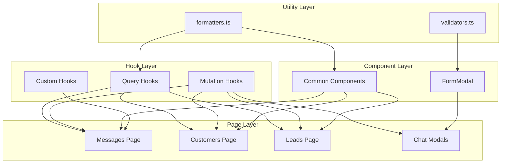

# Design Document: Project Refactoring

## Overview

This design document outlines the technical implementation for refactoring the WhatsApp Business CRM project. The refactoring aims to reduce code duplication, establish consistent patterns, and improve maintainability by extracting utility functions, creating reusable hooks, consolidating modal components, and breaking down large files.

The implementation follows a bottom-up approach: first creating foundational utilities and hooks, then building common components on top of them, and finally refactoring existing pages to use these new abstractions.

## Architecture



## Components and Interfaces

### 1. Utility Functions

#### File: `src/lib/formatters.ts`

```typescript
/**
 * Formats a number as Brazilian Real currency
 * @param value - The numeric value to format
 * @param fallback - Value to return if input is null/undefined (default: '')
 * @returns Formatted currency string (e.g., "R$ 1.234,56")
 */
export function formatCurrency(value: number | null | undefined, fallback = ''): string;

/**
 * Formats a phone number in Brazilian format
 * @param phone - The phone number string
 * @param fallback - Value to return if input is null/undefined (default: '')
 * @returns Formatted phone string (e.g., "(11) 99999-9999")
 */
export function formatPhone(phone: string | null | undefined, fallback = ''): string;

/**
 * Formats a date using pt-BR locale
 * @param date - Date string, Date object, or timestamp
 * @param format - Format pattern (default: 'dd/MM/yyyy')
 * @param fallback - Value to return if input is null/undefined (default: '')
 * @returns Formatted date string
 */
export function formatDate(
  date: string | Date | number | null | undefined,
  format?: string,
  fallback?: string
): string;

/**
 * Formats a date-time value
 * @param date - Date string, Date object, or timestamp
 * @param fallback - Value to return if input is null/undefined (default: '')
 * @returns Formatted date-time string (e.g., "01/01/2024 14:30")
 */
export function formatDateTime(
  date: string | Date | number | null | undefined,
  fallback?: string
): string;

/**
 * Formats a relative time (e.g., "2 hours ago")
 * @param date - Date string, Date object, or timestamp
 * @returns Relative time string in Portuguese
 */
export function formatRelativeTime(date: string | Date | number): string;
```

#### File: `src/lib/validators.ts`

```typescript
/**
 * Validates an email address
 * @param email - The email string to validate
 * @returns true if valid, false otherwise
 */
export function validateEmail(email: string | null | undefined): boolean;

/**
 * Validates a Brazilian phone number
 * @param phone - The phone string to validate
 * @returns true if valid, false otherwise
 */
export function validatePhone(phone: string | null | undefined): boolean;

/**
 * Validates that a value is not empty or whitespace-only
 * @param value - The string to validate
 * @returns true if non-empty, false otherwise
 */
export function validateRequired(value: string | null | undefined): boolean;

/**
 * Validates a Brazilian CPF number
 * @param cpf - The CPF string to validate
 * @returns true if valid, false otherwise
 */
export function validateCPF(cpf: string | null | undefined): boolean;

/**
 * Validates a Brazilian CNPJ number
 * @param cnpj - The CNPJ string to validate
 * @returns true if valid, false otherwise
 */
export function validateCNPJ(cnpj: string | null | undefined): boolean;
```

### 2. Custom Query Hooks

#### File: `src/hooks/queries/useCustomers.ts`

```typescript
import { useQuery } from '@tanstack/react-query';
import { supabase } from '@/integrations/supabase/client';
import { useAuth } from '@/contexts/AuthContext';

export interface Customer {
  id: string;
  name: string;
  email: string | null;
  phone: string | null;
  whatsapp: string | null;
  notes: string | null;
  created_at: string;
  // ... other fields
}

export interface UseCustomersOptions {
  enabled?: boolean;
}

export function useCustomers(options: UseCustomersOptions = {}) {
  const { business } = useAuth();
  
  return useQuery({
    queryKey: ['customers', business?.id],
    queryFn: async () => {
      if (!business?.id) return [];
      const { data, error } = await supabase
        .from('customers')
        .select('*')
        .eq('business_id', business.id)
        .order('created_at', { ascending: false });
      if (error) throw error;
      return data as Customer[];
    },
    enabled: !!business?.id && (options.enabled ?? true),
  });
}
```

#### File: `src/hooks/queries/index.ts`

```typescript
// Re-export all query hooks
export { useCustomers } from './useCustomers';
export { useLeads } from './useLeads';
export { useProducts } from './useProducts';
export { useServices } from './useServices';
export { usePlans } from './usePlans';
export { useInvoices } from './useInvoices';
export { useWhatsAppMessages } from './useWhatsAppMessages';
```

### 3. Custom Mutation Hooks

#### File: `src/hooks/mutations/useMutationWithToast.ts`

```typescript
import { useMutation, useQueryClient, UseMutationOptions } from '@tanstack/react-query';
import { useToast } from '@/hooks/use-toast';

export interface MutationWithToastOptions<TData, TError, TVariables> {
  mutationFn: (variables: TVariables) => Promise<TData>;
  successMessage: string | ((data: TData) => string);
  errorMessage?: string | ((error: TError) => string);
  invalidateKeys?: string[][];
  onSuccess?: (data: TData, variables: TVariables) => void;
  onError?: (error: TError, variables: TVariables) => void;
}

export function useMutationWithToast<TData = unknown, TError = Error, TVariables = void>(
  options: MutationWithToastOptions<TData, TError, TVariables>
) {
  const { toast } = useToast();
  const queryClient = useQueryClient();

  return useMutation({
    mutationFn: options.mutationFn,
    onSuccess: (data, variables) => {
      const message = typeof options.successMessage === 'function'
        ? options.successMessage(data)
        : options.successMessage;
      
      toast({ title: message });
      
      options.invalidateKeys?.forEach(key => {
        queryClient.invalidateQueries({ queryKey: key });
      });
      
      options.onSuccess?.(data, variables);
    },
    onError: (error, variables) => {
      const message = options.errorMessage
        ? (typeof options.errorMessage === 'function'
            ? options.errorMessage(error)
            : options.errorMessage)
        : error instanceof Error
          ? error.message
          : 'An error occurred';
      
      toast({ title: message, variant: 'destructive' });
      
      options.onError?.(error, variables);
    },
  });
}
```

#### File: `src/hooks/mutations/useCustomerMutations.ts`

```typescript
import { supabase } from '@/integrations/supabase/client';
import { useAuth } from '@/contexts/AuthContext';
import { useMutationWithToast } from './useMutationWithToast';
import type { Customer } from '../queries/useCustomers';

export interface CreateCustomerData {
  name: string;
  email?: string;
  phone?: string;
  whatsapp?: string;
  notes?: string;
}

export function useCreateCustomer() {
  const { business } = useAuth();
  
  return useMutationWithToast({
    mutationFn: async (data: CreateCustomerData) => {
      if (!business?.id) throw new Error('Business not found');
      const { data: customer, error } = await supabase
        .from('customers')
        .insert({ ...data, business_id: business.id })
        .select()
        .single();
      if (error) throw error;
      return customer as Customer;
    },
    successMessage: 'Cliente criado com sucesso!',
    errorMessage: 'Erro ao criar cliente',
    invalidateKeys: [['customers']],
  });
}

export function useUpdateCustomer() {
  return useMutationWithToast({
    mutationFn: async ({ id, data }: { id: string; data: Partial<CreateCustomerData> }) => {
      const { error } = await supabase
        .from('customers')
        .update(data)
        .eq('id', id);
      if (error) throw error;
    },
    successMessage: 'Cliente atualizado!',
    errorMessage: 'Erro ao atualizar cliente',
    invalidateKeys: [['customers']],
  });
}

export function useDeleteCustomer() {
  return useMutationWithToast({
    mutationFn: async (id: string) => {
      const { error } = await supabase
        .from('customers')
        .delete()
        .eq('id', id);
      if (error) throw error;
    },
    successMessage: 'Cliente removido!',
    errorMessage: 'Erro ao remover cliente',
    invalidateKeys: [['customers']],
  });
}
```

### 4. Common Components

#### File: `src/components/common/LoadingState.tsx`

```typescript
import { Loader2 } from 'lucide-react';
import { cn } from '@/lib/utils';

export interface LoadingStateProps {
  message?: string;
  size?: 'sm' | 'md' | 'lg';
  className?: string;
}

const sizeMap = {
  sm: 'h-4 w-4',
  md: 'h-6 w-6',
  lg: 'h-8 w-8',
};

export function LoadingState({ message, size = 'md', className }: LoadingStateProps) {
  return (
    <div className={cn('flex flex-col items-center justify-center py-8', className)}>
      <Loader2 className={cn('animate-spin text-muted-foreground', sizeMap[size])} />
      {message && (
        <p className="mt-2 text-sm text-muted-foreground">{message}</p>
      )}
    </div>
  );
}
```

#### File: `src/components/common/EmptyState.tsx`

```typescript
import { LucideIcon } from 'lucide-react';
import { Button } from '@/components/ui/button';
import { cn } from '@/lib/utils';

export interface EmptyStateProps {
  icon?: LucideIcon;
  title: string;
  description?: string;
  action?: {
    label: string;
    onClick: () => void;
  };
  className?: string;
}

export function EmptyState({ icon: Icon, title, description, action, className }: EmptyStateProps) {
  return (
    <div className={cn('flex flex-col items-center justify-center py-12 text-center', className)}>
      {Icon && <Icon className="h-12 w-12 text-muted-foreground/50 mb-4" />}
      <h3 className="text-lg font-medium text-foreground">{title}</h3>
      {description && (
        <p className="mt-1 text-sm text-muted-foreground max-w-sm">{description}</p>
      )}
      {action && (
        <Button onClick={action.onClick} className="mt-4">
          {action.label}
        </Button>
      )}
    </div>
  );
}
```

#### File: `src/components/common/DataTable.tsx`

```typescript
import { Table, TableBody, TableCell, TableHead, TableHeader, TableRow } from '@/components/ui/table';
import { LoadingState } from './LoadingState';
import { EmptyState } from './EmptyState';
import { LucideIcon } from 'lucide-react';

export interface Column<T> {
  key: string;
  header: string;
  accessor: keyof T | ((row: T) => React.ReactNode);
  render?: (value: any, row: T) => React.ReactNode;
  className?: string;
}

export interface DataTableProps<T> {
  columns: Column<T>[];
  data: T[];
  isLoading?: boolean;
  emptyState?: {
    icon?: LucideIcon;
    title: string;
    description?: string;
    action?: { label: string; onClick: () => void };
  };
  onRowClick?: (row: T) => void;
  rowKey: keyof T | ((row: T) => string);
}

export function DataTable<T>({
  columns,
  data,
  isLoading,
  emptyState,
  onRowClick,
  rowKey,
}: DataTableProps<T>) {
  if (isLoading) {
    return <LoadingState message="Carregando..." />;
  }

  if (data.length === 0 && emptyState) {
    return <EmptyState {...emptyState} />;
  }

  const getRowKey = (row: T, index: number): string => {
    if (typeof rowKey === 'function') return rowKey(row);
    return String(row[rowKey]) || String(index);
  };

  const getCellValue = (row: T, column: Column<T>) => {
    const value = typeof column.accessor === 'function'
      ? column.accessor(row)
      : row[column.accessor];
    
    if (column.render) {
      return column.render(value, row);
    }
    return value;
  };

  return (
    <Table>
      <TableHeader>
        <TableRow>
          {columns.map((column) => (
            <TableHead key={column.key} className={column.className}>
              {column.header}
            </TableHead>
          ))}
        </TableRow>
      </TableHeader>
      <TableBody>
        {data.map((row, index) => (
          <TableRow
            key={getRowKey(row, index)}
            onClick={() => onRowClick?.(row)}
            className={onRowClick ? 'cursor-pointer hover:bg-muted/50' : undefined}
          >
            {columns.map((column) => (
              <TableCell key={column.key} className={column.className}>
                {getCellValue(row, column)}
              </TableCell>
            ))}
          </TableRow>
        ))}
      </TableBody>
    </Table>
  );
}
```

### 5. FormModal Component

#### File: `src/components/common/FormModal.tsx`

```typescript
import { useState, useEffect } from 'react';
import { Dialog, DialogContent, DialogDescription, DialogHeader, DialogTitle } from '@/components/ui/dialog';
import { Button } from '@/components/ui/button';
import { Input } from '@/components/ui/input';
import { Label } from '@/components/ui/label';
import { Textarea } from '@/components/ui/textarea';
import { Select, SelectContent, SelectItem, SelectTrigger, SelectValue } from '@/components/ui/select';
import { Switch } from '@/components/ui/switch';
import { Loader2, LucideIcon } from 'lucide-react';

export type FieldType = 'text' | 'email' | 'number' | 'date' | 'time' | 'textarea' | 'select' | 'switch';

export interface SelectOption {
  value: string;
  label: string;
}

export interface FormField {
  name: string;
  label: string;
  type: FieldType;
  placeholder?: string;
  required?: boolean;
  options?: SelectOption[];
  rows?: number;
  min?: number | string;
  max?: number | string;
  step?: number | string;
  defaultValue?: any;
  visibleWhen?: (values: Record<string, any>) => boolean;
  validate?: (value: any, values: Record<string, any>) => string | undefined;
}

export interface FormModalProps {
  open: boolean;
  onOpenChange: (open: boolean) => void;
  title: string;
  description?: string;
  icon?: LucideIcon;
  fields: FormField[];
  initialValues?: Record<string, any>;
  onSubmit: (values: Record<string, any>) => void | Promise<void>;
  isLoading?: boolean;
  submitLabel?: string;
  cancelLabel?: string;
}

export function FormModal({
  open,
  onOpenChange,
  title,
  description,
  icon: Icon,
  fields,
  initialValues = {},
  onSubmit,
  isLoading,
  submitLabel = 'Salvar',
  cancelLabel = 'Cancelar',
}: FormModalProps) {
  const [values, setValues] = useState<Record<string, any>>({});
  const [errors, setErrors] = useState<Record<string, string>>({});

  // Initialize form values when modal opens
  useEffect(() => {
    if (open) {
      const initial: Record<string, any> = {};
      fields.forEach((field) => {
        initial[field.name] = initialValues[field.name] ?? field.defaultValue ?? '';
      });
      setValues(initial);
      setErrors({});
    }
  }, [open, fields, initialValues]);

  const handleChange = (name: string, value: any) => {
    setValues((prev) => ({ ...prev, [name]: value }));
    // Clear error when field changes
    if (errors[name]) {
      setErrors((prev) => ({ ...prev, [name]: '' }));
    }
  };

  const validateForm = (): boolean => {
    const newErrors: Record<string, string> = {};
    
    fields.forEach((field) => {
      // Skip validation for hidden fields
      if (field.visibleWhen && !field.visibleWhen(values)) return;
      
      const value = values[field.name];
      
      // Required validation
      if (field.required && (value === '' || value === null || value === undefined)) {
        newErrors[field.name] = 'Campo obrigatório';
        return;
      }
      
      // Custom validation
      if (field.validate) {
        const error = field.validate(value, values);
        if (error) {
          newErrors[field.name] = error;
        }
      }
    });
    
    setErrors(newErrors);
    return Object.keys(newErrors).length === 0;
  };

  const handleSubmit = async (e: React.FormEvent) => {
    e.preventDefault();
    if (!validateForm()) return;
    await onSubmit(values);
  };

  const renderField = (field: FormField) => {
    // Check visibility condition
    if (field.visibleWhen && !field.visibleWhen(values)) {
      return null;
    }

    const value = values[field.name] ?? '';
    const error = errors[field.name];

    switch (field.type) {
      case 'textarea':
        return (
          <div key={field.name} className="space-y-2">
            <Label htmlFor={field.name}>{field.label}{field.required && ' *'}</Label>
            <Textarea
              id={field.name}
              value={value}
              onChange={(e) => handleChange(field.name, e.target.value)}
              placeholder={field.placeholder}
              rows={field.rows || 3}
            />
            {error && <p className="text-sm text-destructive">{error}</p>}
          </div>
        );

      case 'select':
        return (
          <div key={field.name} className="space-y-2">
            <Label htmlFor={field.name}>{field.label}{field.required && ' *'}</Label>
            <Select value={value} onValueChange={(v) => handleChange(field.name, v)}>
              <SelectTrigger>
                <SelectValue placeholder={field.placeholder || 'Selecione...'} />
              </SelectTrigger>
              <SelectContent>
                {field.options?.map((option) => (
                  <SelectItem key={option.value} value={option.value}>
                    {option.label}
                  </SelectItem>
                ))}
              </SelectContent>
            </Select>
            {error && <p className="text-sm text-destructive">{error}</p>}
          </div>
        );

      case 'switch':
        return (
          <div key={field.name} className="flex items-center justify-between">
            <Label htmlFor={field.name}>{field.label}</Label>
            <Switch
              id={field.name}
              checked={!!value}
              onCheckedChange={(checked) => handleChange(field.name, checked)}
            />
          </div>
        );

      default:
        return (
          <div key={field.name} className="space-y-2">
            <Label htmlFor={field.name}>{field.label}{field.required && ' *'}</Label>
            <Input
              id={field.name}
              type={field.type}
              value={value}
              onChange={(e) => handleChange(field.name, e.target.value)}
              placeholder={field.placeholder}
              min={field.min}
              max={field.max}
              step={field.step}
            />
            {error && <p className="text-sm text-destructive">{error}</p>}
          </div>
        );
    }
  };

  return (
    <Dialog open={open} onOpenChange={onOpenChange}>
      <DialogContent className="sm:max-w-md max-h-[90vh] overflow-y-auto">
        <DialogHeader>
          <DialogTitle className="flex items-center gap-2">
            {Icon && <Icon className="h-5 w-5" />}
            {title}
          </DialogTitle>
          {description && <DialogDescription>{description}</DialogDescription>}
        </DialogHeader>

        <form onSubmit={handleSubmit} className="space-y-4">
          {fields.map(renderField)}

          <div className="flex justify-end gap-3 pt-4">
            <Button type="button" variant="outline" onClick={() => onOpenChange(false)}>
              {cancelLabel}
            </Button>
            <Button type="submit" disabled={isLoading}>
              {isLoading && <Loader2 className="mr-2 h-4 w-4 animate-spin" />}
              {submitLabel}
            </Button>
          </div>
        </form>
      </DialogContent>
    </Dialog>
  );
}
```

### 6. Messages Page Hooks

#### File: `src/hooks/messages/useConversations.ts`

```typescript
import { useMemo } from 'react';
import { Conversation, ConversationStatus } from '@/components/chat/ConversationsList';

interface WhatsAppMessage {
  id: string;
  phone: string;
  message: string;
  direction: 'inbound' | 'outbound';
  status: string;
  created_at: string;
  sender_name: string | null;
  lead_id: string | null;
  customer_id: string | null;
  is_group?: boolean;
  group_name?: string | null;
  participant_count?: number;
  sender_avatar_url?: string | null;
  conversation_status?: ConversationStatus;
}

export function useConversations(messages: WhatsAppMessage[]): Conversation[] {
  return useMemo(() => {
    const unreadCountByPhone = new Map<string, number>();

    for (const m of messages) {
      if (m.direction === 'inbound' && m.status === 'pending') {
        unreadCountByPhone.set(m.phone, (unreadCountByPhone.get(m.phone) || 0) + 1);
      }
    }

    const phoneMap = new Map<string, Conversation>();

    for (const msg of messages) {
      const isGroup = msg.phone.startsWith('group:') || msg.is_group;
      const existing = phoneMap.get(msg.phone);

      if (!existing) {
        phoneMap.set(msg.phone, {
          phone: msg.phone,
          sender_name: msg.sender_name,
          lead_id: msg.lead_id,
          customer_id: msg.customer_id,
          last_message: msg.message,
          last_message_at: msg.created_at,
          unread_count: unreadCountByPhone.get(msg.phone) || 0,
          direction: msg.direction,
          is_group: isGroup,
          group_name: msg.group_name,
          participant_count: msg.participant_count || 0,
          avatar_url: msg.sender_avatar_url,
          conversation_status: msg.conversation_status || 'pending',
        });
        continue;
      }

      // Complete missing data
      if (isGroup) {
        if (!existing.group_name && msg.group_name) existing.group_name = msg.group_name;
        if ((msg.participant_count || 0) > (existing.participant_count || 0)) {
          existing.participant_count = msg.participant_count || existing.participant_count || 0;
        }
      }

      if (!existing.sender_name && msg.sender_name) existing.sender_name = msg.sender_name;
      if (!existing.lead_id && msg.lead_id) existing.lead_id = msg.lead_id;
      if (!existing.customer_id && msg.customer_id) existing.customer_id = msg.customer_id;
      if (!existing.avatar_url && msg.sender_avatar_url) existing.avatar_url = msg.sender_avatar_url;
    }

    return Array.from(phoneMap.values()).sort(
      (a, b) => new Date(b.last_message_at).getTime() - new Date(a.last_message_at).getTime()
    );
  }, [messages]);
}
```

#### File: `src/hooks/messages/useMessagesModals.ts`

```typescript
import { useState, useCallback } from 'react';

export interface MessagesModalsState {
  addCustomer: boolean;
  opportunity: boolean;
  invoice: boolean;
  schedule: boolean;
  templates: boolean;
  bulkMessage: boolean;
  extractContacts: boolean;
  scheduledList: boolean;
}

export function useMessagesModals() {
  const [modals, setModals] = useState<MessagesModalsState>({
    addCustomer: false,
    opportunity: false,
    invoice: false,
    schedule: false,
    templates: false,
    bulkMessage: false,
    extractContacts: false,
    scheduledList: false,
  });

  const openModal = useCallback((modal: keyof MessagesModalsState) => {
    setModals((prev) => ({ ...prev, [modal]: true }));
  }, []);

  const closeModal = useCallback((modal: keyof MessagesModalsState) => {
    setModals((prev) => ({ ...prev, [modal]: false }));
  }, []);

  const toggleModal = useCallback((modal: keyof MessagesModalsState) => {
    setModals((prev) => ({ ...prev, [modal]: !prev[modal] }));
  }, []);

  return {
    modals,
    openModal,
    closeModal,
    toggleModal,
  };
}
```

## Data Models

### Utility Types

```typescript
// src/types/common.ts

export interface PaginatedResponse<T> {
  data: T[];
  total: number;
  page: number;
  pageSize: number;
}

export interface ApiError {
  message: string;
  code?: string;
  details?: Record<string, any>;
}

export type FormValues = Record<string, any>;
```

### Entity Types

```typescript
// src/types/entities.ts

export interface Customer {
  id: string;
  business_id: string;
  name: string;
  email: string | null;
  phone: string | null;
  whatsapp: string | null;
  notes: string | null;
  interest_type: string | null;
  interested_product_id: string | null;
  interested_service_id: string | null;
  interest_is_recurring: boolean | null;
  recurring_due_date: string | null;
  recurring_message_time: string | null;
  recurring_reminder_days: number | null;
  recurring_message_type: string | null;
  created_at: string;
  updated_at: string;
}

export interface Lead {
  id: string;
  business_id: string;
  name: string;
  email: string | null;
  phone: string | null;
  whatsapp: string | null;
  company: string | null;
  source: string | null;
  temperature: 'cold' | 'warm' | 'hot' | null;
  status: string;
  created_at: string;
  updated_at: string;
}

export interface Product {
  id: string;
  business_id: string;
  name: string;
  description: string | null;
  price: number;
  is_active: boolean;
  created_at: string;
}

export interface Service {
  id: string;
  business_id: string;
  name: string;
  description: string | null;
  price: number;
  is_active: boolean;
  created_at: string;
}

export interface WhatsAppMessage {
  id: string;
  business_id: string;
  user_id: string;
  phone: string;
  message: string;
  direction: 'inbound' | 'outbound';
  status: 'pending' | 'sent' | 'delivered' | 'read' | 'failed';
  media_url: string | null;
  media_type: string | null;
  sender_name: string | null;
  lead_id: string | null;
  customer_id: string | null;
  is_group: boolean;
  group_name: string | null;
  participant_phone: string | null;
  conversation_status: 'pending' | 'inbox' | 'archived';
  created_at: string;
}
```


## Correctness Properties

*A property is a characteristic or behavior that should hold true across all valid executions of a system—essentially, a formal statement about what the system should do. Properties serve as the bridge between human-readable specifications and machine-verifiable correctness guarantees.*

Based on the prework analysis, the following properties have been identified for property-based testing:

### Property 1: Formatter Output Format Validity

*For any* valid numeric input to `formatCurrency`, the output string SHALL match the Brazilian Real currency format pattern (starting with "R$" followed by properly formatted number with thousands separators and decimal comma).

*For any* valid phone string input to `formatPhone`, the output string SHALL match the Brazilian phone format pattern `(XX) XXXXX-XXXX` or `(XX) XXXX-XXXX`.

*For any* valid Date input to `formatDate` or `formatDateTime`, the output string SHALL be a valid date representation in pt-BR locale.

**Validates: Requirements 1.1, 1.2, 1.3, 1.4**

### Property 2: Validator Correctness

*For any* string that matches the email regex pattern `^[^\s@]+@[^\s@]+\.[^\s@]+$`, `validateEmail` SHALL return true.

*For any* string that matches the Brazilian phone pattern (10-11 digits starting with valid DDD), `validatePhone` SHALL return true.

*For any* string that contains at least one non-whitespace character, `validateRequired` SHALL return true.

**Validates: Requirements 1.5, 1.6, 1.7**

### Property 3: Null/Undefined Handling Consistency

*For any* formatter function (`formatCurrency`, `formatPhone`, `formatDate`, `formatDateTime`), when called with null or undefined, the function SHALL return the fallback value (empty string by default).

*For any* validator function (`validateEmail`, `validatePhone`, `validateRequired`), when called with null or undefined, the function SHALL return false.

**Validates: Requirements 1.8, 1.9**

### Property 4: FormModal Field Rendering

*For any* valid field configuration array passed to FormModal, the component SHALL render exactly one input element for each field in the configuration where `visibleWhen` returns true or is not specified.

**Validates: Requirements 4.4**

### Property 5: FormModal Required Field Validation

*For any* FormModal with required fields, when the form is submitted with any required field empty or containing only whitespace, the `onSubmit` callback SHALL NOT be invoked.

**Validates: Requirements 4.9**

### Property 6: FormModal Conditional Field Visibility

*For any* field with a `visibleWhen` function, the field SHALL be rendered if and only if `visibleWhen(currentValues)` returns true.

**Validates: Requirements 4.11**

### Property 7: DataTable Data Rendering Consistency

*For any* DataTable with a columns configuration and data array, the component SHALL render exactly `data.length` rows and exactly `columns.length` cells per row.

*For any* column with an accessor function, the cell content SHALL be the result of calling the accessor with the row data.

**Validates: Requirements 5.3, 5.7, 5.8**

## Error Handling

### Utility Functions

- **Formatters**: Return fallback value (empty string by default) for null/undefined inputs. For invalid inputs (e.g., non-numeric string to formatCurrency), return the fallback value without throwing.
- **Validators**: Return false for null/undefined inputs. Never throw exceptions.

### Query Hooks

- **Network Errors**: Expose error through the `error` property of the returned object. Do not show toast notifications (let components handle display).
- **Empty Business ID**: Return empty array immediately without making network request.
- **Supabase Errors**: Rethrow to let React Query handle retry logic.

### Mutation Hooks

- **Success**: Display success toast, invalidate related queries, call optional onSuccess callback.
- **Failure**: Display error toast with message, call optional onError callback. Do not invalidate queries.
- **Network Errors**: Caught by React Query, displayed via error toast.

### FormModal

- **Validation Errors**: Display inline error messages below fields. Prevent form submission.
- **Submit Errors**: Handled by parent component via mutation error handling.
- **Missing Required Props**: TypeScript will catch at compile time.

### Common Components

- **LoadingState**: No error states (purely presentational).
- **EmptyState**: No error states (purely presentational).
- **DataTable**: Display LoadingState during loading, EmptyState when data is empty.

## Testing Strategy

### Dual Testing Approach

This refactoring will use both unit tests and property-based tests:

- **Unit tests**: Verify specific examples, edge cases, integration points, and error conditions
- **Property tests**: Verify universal properties across all valid inputs using randomized testing

### Property-Based Testing Configuration

- **Library**: fast-check (TypeScript property-based testing library)
- **Minimum iterations**: 100 per property test
- **Tag format**: `Feature: project-refactoring, Property {number}: {property_text}`

### Test Organization

```
src/
├── lib/
│   ├── formatters.ts
│   ├── formatters.test.ts          # Unit tests + Property tests
│   ├── validators.ts
│   └── validators.test.ts          # Unit tests + Property tests
├── hooks/
│   ├── queries/
│   │   ├── useCustomers.ts
│   │   └── useCustomers.test.ts    # Integration tests
│   └── mutations/
│       ├── useMutationWithToast.ts
│       └── useMutationWithToast.test.ts  # Integration tests
└── components/
    └── common/
        ├── FormModal.tsx
        ├── FormModal.test.tsx      # Unit tests + Property tests
        ├── DataTable.tsx
        └── DataTable.test.tsx      # Unit tests + Property tests
```

### Unit Test Coverage

1. **Formatters**: Test specific format outputs, edge cases (0, negative numbers, very large numbers)
2. **Validators**: Test valid/invalid examples, boundary cases
3. **Query Hooks**: Test with mocked Supabase, verify query keys, test enabled conditions
4. **Mutation Hooks**: Test success/error flows, verify toast calls, verify query invalidation
5. **FormModal**: Test field rendering, validation, submission, reset behavior
6. **DataTable**: Test column rendering, row clicks, loading/empty states

### Property Test Implementation

Each property test must:
1. Reference its design document property number
2. Run minimum 100 iterations
3. Use appropriate generators for input types
4. Include shrinking for failure case minimization

Example property test structure:

```typescript
import fc from 'fast-check';
import { formatCurrency } from './formatters';

describe('formatters', () => {
  // Feature: project-refactoring, Property 1: Formatter Output Format Validity
  it('formatCurrency output matches BRL format for any valid number', () => {
    fc.assert(
      fc.property(fc.double({ min: -1e12, max: 1e12, noNaN: true }), (num) => {
        const result = formatCurrency(num);
        // Verify starts with R$ and contains proper formatting
        expect(result).toMatch(/^R\$\s?-?[\d.,]+$/);
      }),
      { numRuns: 100 }
    );
  });
});
```
