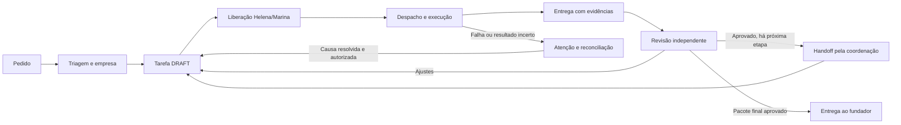

# Sistema Helena — mapa operacional de ponta a ponta

Fotografia de 02/10/2026. Fonte de verdade: Supabase `wxkgrykduqtsgmjkzlou`; Hermes executa perfis, Gateway valida as ações e R2 guarda os arquivos. Este mapa distingue **comprovado em produção**, **testado localmente** e **ainda pendente**. Nenhum teste de configuração, prompt ou arquivo equivale a uma entrega real aprovada.

## O percurso que todo pedido deve completar

1. **Receber e classificar — Helena (AGT-01).** Separar relato, consulta, pedido de registro e ordem de execução. Identificar empresa, objetivo, formato, destino, prazo, material de origem e quem aprova. Perguntar só o que bloqueia a próxima ação. Um relato de gasto não é lançamento; um pedido de copy não autoriza publicação. Prova: resposta com campos faltantes e nenhuma escrita prematura. A regra compartilhada foi instalada nos 21 `SOUL.md`; um canário real da Helena com “Teste hipotético, sem registro e sem criar tarefa: Gastei R$ 100” pediu empresa, finalidade, data, situação do pagamento e comprovante, declarando que nada foi lançado.
2. **Resolver identidade e escopo — Gateway/Supabase.** A chamada deve autenticar o perfil individual, confirmar papel ativo, empresa correta e tipo de escopo. Helena é GROUP, Laura é PERSONAL e os demais perfis empresariais têm vínculo próprio; não transportar dados entre empresas. Prova: `get_work_context` não truncado, binding ativo e rejeições cruzadas. Perfil conectado só prova acesso, não capacidade de executar a função.
3. **Criar o trabalho — Helena ou Marina.** `create_task_job`/`adopt_existing_task` cria ou vincula uma única tarefa e um job `DRAFT`, com instrução, definição de pronto, dependências, agente e critério de revisão. Brief de design deve trazer marca aprovada, copy, formatos, composição e fonte. Prova: IDs, versão e empresa confirmados por `get_job`; não se inicia modelo nessa fase. Entradas longas precisam ser condensadas antes da chamada, preservando copy literal e critérios; uma recusa por tamanho não deve ser repetida sem mudança.
4. **Liberar — Helena ou Marina.** `release_job` valida executor ativo, insumos, limite de tentativas e WIP global 1. O job passa a `READY`; a liberação não é a execução. Prova: versão, evento de liberação e status atual. Se há decisão comercial/credencial/fonte pendente, manter bloqueio com dono e próximo passo.
5. **Despachar — consumidor no Hermes.** `hermes_pipeline.py` coordena `hermes_dispatch_once.py` e `hermes_workflow_tick.py` em até seis ações por rodada. O despacho automático exige `DISPATCH_REQUESTED` válido ou liberação gerencial correspondente, preflight do perfil/MCP/modelo, trava de concorrência, `claim_job` e `start_job` confirmados. `HELENA_DISPATCH_ENABLED=1` é exigido para executar. Prova: eventos de claim/start e perfil correto. Resposta de rede incerta significa reconciliar eventos, nunca repetir chamada paga às cegas.
6. **Produzir — especialista designado.** O agente executa só seu domínio e sua empresa, registra progresso/memória com fonte e produz o artefato requerido. Para imagem, arquivo existente, dimensão e hash são verificações técnicas; a peça ainda precisa conter conteúdo, identidade visual, legibilidade e variedade. Prova: `submit_work`/`submit_delivery`, referências de evidência do próprio job e `publication` quando aplicável. Um texto técnico interno não pode ocupar o campo de legenda pública.
7. **Revisar — agente independente indicado.** `review_delivery` só aprova com critérios e evidências verificadas da versão atual. Para artes, Nina/avaliador abre cada imagem por `get_visual_asset` e registra `visual_review`. Falta de acesso ou peça ruim exige `REQUEST_CHANGES` com correções específicas; executor não se autoaprova. Prova: evento de revisão, autor e achados, não apenas status no cartão.
8. **Corrigir — mesmo job quando permitido.** Após `REQUEST_CHANGES`, Helena/Marina lê o parecer, usa `revise_task_brief` com versão atual se necessário, e só libera após conferir insumos e tentativas. A nova entrega volta a revisor independente. Se o limite foi esgotado ou o efeito da execução é incerto, parar e reconciliar; não criar sucessora para burlar orçamento. Prova: histórico preservado, nova versão, nova evidência e nova revisão.
9. **Passar ao próximo agente — coordenação.** Só Helena/Marina pode chamar `handoff_task` após aprovação independente, com próximo dono e insumos explícitos. O filho nasce `DRAFT` e precisa de liberação própria. O consumidor procura evento de handoff já registrado para evitar duplicata após queda. Prova: job filho vinculado, empresa certa, evento único e liberação separada.
10. **Entregar ao fundador — pacote final.** A etapa final não se confunde com plano, briefing ou peça isolada. Exibir imagem real acessível, copy pronta para o canal, estratégia, o que foi aprovado e o que ainda depende de decisão. Dados técnicos e hashes ficam na auditoria, não no material para postar. Prova: abrir a página de Entregas, conferir os pixels, copiar a legenda e seguir a CTA sem inventar link. Não publicar/enviar a terceiros só porque o pacote foi aprovado internamente.
11. **Vigiar e recuperar — sem IA por padrão.** `hermes_queue_watchdog.py` foi escrito para localizar falhas, execução antiga e bloqueios esgotados, registrar atenção idempotente e apontar Helena/Theo; não reinicia agente nem altera tentativas. O estado canônico deve permitir retomar após reinício do serviço. Prova: teste de queda, leitura da fila, evento de atenção único e ação humana/gerencial definida.
12. **Mostrar andamento — Supabase/UI/Kanban.** As páginas executivas leem o estado oficial. O Kanban Hermes, quando usado, é espelho de `agent_jobs`, nunca um segundo despachante. A sincronização exige despacho Kanban nativo desligado em todos os perfis. Prova: cartão com mesmo job/status/empresa e atualização após transição, sem execução criada pelo espelho.

## Resultado desta conferência

- **Comprovado agora:** 21/21 perfis têm hash e regra de triagem verificados no Hermes; o canário da Helena não registrou a despesa hipotética. `workflow-config.json` remoto tem `durable_continuity=true` e 21 papéis. O script do poll e os três componentes principais existem. O último `pipeline-last-result.json` foi gravado em **02/10/2026 16:26:12 UTC**, com `NO_APPROVED_READY_JOB` e `ATTEMPT_LIMIT`; havia 17 recibos locais e zero continuações pendentes no arquivo. Isto prova uma rodada recente e uma parada segura, não prova que todas as tarefas foram concluídas.
- **Testado localmente nesta conferência:** 61 testes Node de contratos/fluxo, 131 testes Python do despachante/revisão/preflight/triagem e 17 testes Python do pipeline, vigilante e espelho Kanban passaram. São testes determinísticos; não substituem execução de produção.
- **Falha comprovada em produção:** `queue_attention` devolveu HTTP 400 com `Could not find the function public.gateway_list_recovery_candidates(p_after_job_id, p_created_after, p_limit, p_profile_slug) in the schema cache`. A função está no arquivo local `supabase/migrations/20261001090000_durable_agent_recovery.sql`, mas não está disponível ao Gateway. Não afirmar que essa migration foi aplicada só porque o arquivo existe. `hermes_queue_watchdog.py` e `queue-watchdog-last-result.json` também não estão no runtime remoto; logo a vigilância autônoma de exceções **não está operante**.
- **Não confirmado:** o agendamento externo do poll. O container Hermes não oferece `crontab`; o arquivo de resultado recente mostra que houve uma invocação, mas não demonstra frequência nem supervisão após falha. É preciso conferir o agendador no host/EasyPanel e medir duas execuções em horários esperados.
- **Pendência real:** `ATTEMPT_LIMIT` preserva uma tarefa esgotada sem repetição paga. Isso é seguro, mas não resolve a pendência: a coordenação precisa verificar causa, efeitos e decidir o próximo passo legítimo. O recibo `docs/RECIBO-AUTORIDADE-AGENTES-20261002.json` registra a campanha `HD-CASA-20261002-01` ainda sem handoff sucessor confirmado. Não atribuir esse status a todas as tarefas sem consultar o Supabase atual.
- **Capacidade ausente:** não foi encontrada ferramenta de escrita financeira de domínio no `helena_operacao`; a Helena pode triar um gasto, mas não se pode afirmar que ela o lançou em `financeiro`. A mesma distinção entre proposta, autorização e efeito deve valer para jurídico, RH, campanha, atendimento, cobrança e publicação.
- **Cobertura ainda não demonstrada:** 21/21 regras e contratos não são 21/21 cenários reais. Falta homologar ao menos uma passagem completa com devolução, correção, nova revisão e entrega visível, e canários por domínio para os outros perfis. O [mapa individual dos 21 agentes](./MAPA-TRIAGEM-21-AGENTES-20261002.md) especifica os riscos de cada papel.

## Ordem de correção e critério de aceite

1. **Restaurar a fila de atenção no banco.** Conferir o estado de migrations do projeto canônico e aplicar a função de `20261001090000_durable_agent_recovery.sql` somente após validar dependências e autorização de mudança de banco. Testar leitura com Helena e Marina; perfil especialista/pessoal deve ser recusado. Recarregar esquema apenas se necessário e repetir `queue_attention` até retornar `success=true`, sem chamada de modelo.
2. **Instalar e acionar o vigilante sem duplicar o despachante.** Com a API acima comprovada, instalar `hermes_queue_watchdog.py` com backup, executar primeiro leitura seca e depois um alerta interno idempotente de falha conhecida. Conferir duas rodadas e evento único. Definir frequência e supervisão no agendador que já roda o poll; falha do vigilante precisa aparecer como alerta, não como conclusão falsa. Sem o passo 1, instalar só o arquivo não resolve.
3. **Reconciliar a pendência esgotada.** Consultar `get_job` e eventos do job específico, confirmar se houve entrega/handoff ou efeito incerto, nomear a causa e responsável. Preservar tentativas e WIP. Só liberar ou planejar sucessor segundo as regras vigentes, com autorização e chave estável.
4. **Homologar um ciclo completo barato.** Usar uma tarefa pequena já autorizada, um especialista e revisor; provar DRAFT → READY → CLAIMED/RUNNING → entrega → REQUEST_CHANGES → correção → APPROVE → handoff/final → Entregas. Simular falha de rede e reinício em testes determinísticos antes da chamada paga. Para arte, abrir cada arquivo e avaliar copy, logo, contraste, composição e diversidade; não aprovar por hash ou tamanho.
5. **Expandir por domínio, sem ativar 21 modelos em paralelo.** Para cada agente do mapa individual: teste de entrada incompleta, empresa errada, ferramenta ausente, recusa segura, versão antiga, idempotência e resultado visível. Registrar `CONFIGURADO`, `CENÁRIO TESTADO` e `CICLO REAL APROVADO` separadamente. Só adicionar ações externas (pagamento, assinatura, mensagem, publicação) quando houver conector próprio, autorização específica, auditoria e leitura do efeito.

Critério para dizer “100%”: todas as transições acima demonstradas em produção para os domínios ativados, monitoramento e recuperação comprovados após falha, e resultado final aceito pelo fundador. Não existe garantia técnica de “nunca mais falhar”; a meta verificável é **falhar fechado, explicar, recuperar sem duplicar gasto ou envio e entregar algo utilizável**.
