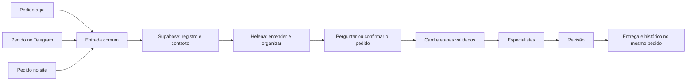

# Pedido único pelo Codex, site e Telegram

Contrato e estado de implementação de 17/10/2026. Não implantado. O fundador autorizou os ajustes nesta sessão; faltam acesso autenticado e leitura do contexto vigente para aplicar mudanças reais.

## Preparado localmente

- Migration `0021_pedido_entrada.sql`: recepção, leitura e listagem restritas ao fundador autenticado, sem criar card ou job.
- Site: texto livre, recibo, recuperação idempotente, histórico por acompanhamento e Kanban dos cards.
- Reenvios do mesmo evento são idempotentes; texto ou acompanhamento divergente com a mesma chave gera conflito. Um novo evento com o mesmo acompanhamento é continuação explícita.
- A origem SITE/CODEX/TELEGRAM é metadado declarado por uma sessão autenticada, **não prova de pareamento**. Somente a entrada do site foi implementada no cliente. O bot e esta conversa ainda não enviam pedidos à v2.
- Triagem pela IA, esclarecimentos, conversão confirmada em card e pareamento dos canais continuam pendentes. Recebimento não é execução.

## Experiência do fundador

1. Você faz um pedido de trabalho em qualquer canal.
2. Recebe um número de acompanhamento; o pedido já aparece na triagem do Kanban.
3. Helena consulta o contexto vigente do Supabase e propõe empresa, serviço, resultado e etapas. Fatos têm fonte e versão; informação ausente vira uma pergunta.
4. O código confere serviço, permissões, insumos, orçamento e revisores obrigatórios. Você confere a leitura de volta antes da execução.
5. O pedido fica ligado a um único card executável. Agentes trabalham, outro agente revisa, e a entrega volta ao mesmo acompanhamento.
6. Enviar, publicar ou pagar continuam sujeitos às autorizações próprias dessas ações.

## O que o código atual permite

- Supabase Auth e `app_access` identificam o fundador. O login OpenAI do Hermes não substitui essa identidade.
- A v2 já possui estados do card, etapas, revisores, confirmação do fundador, histórico, controle de versão e ações externas separadas.
- O fluxo executável real atual aceita uma tarefa capturada de `public.tarefas` com plano pronto. O recebimento de texto livre preparado localmente fica separado desse fluxo até a conversão.
- O card `RASCUNHO` já precisa de roteiro e etapas. Criar um card vazio para uma frase ainda não entendida mudaria a máquina e poderia acionar relógio e despacho indevidamente.
- A tela local agora tem Kanban e preserva detalhes, entregas, perguntas e decisões. Publicação real ainda não conferida.

## Menor implementação completa a preparar

**Entrada persistida antes da execução.** A migration 0021 cria o pedido de triagem e RPCs autenticadas. O pedido recebe `pedido_id` e `request_id`; a interface mostra o recebimento em triagem, separado do trabalho planejado. A conversão ainda precisa atribuir `card_id` com vínculo único. Não fabricar tarefa da v1 nem chamar a função antiga de criação a partir do bot.

**Proposta tipada da Helena.** A IA propõe tipo de mensagem, empresa, serviço, objetivo, prazo, fontes e ambiguidades. O código confere os identificadores da revisão vigente e monta as etapas previstas na configuração. Serviços de texto que exigem Parecer conservam esse requisito. Uma proposta incompleta permanece aguardando esclarecimento; não se transforma silenciosamente em ordem de execução.

**Contexto compartilhado.** Ler o checkpoint vigente, decisões, configuração e pedidos relacionados com permissões e limites de empresa. Guardar referências, versão e o que foi confirmado. Não prometer entendimento de toda informação sem consultá-la nem usar um documento antigo como estado atual.

**Identidade nos dois canais.** O pareamento do Telegram começa no site autenticado, usa autorização temporária e vincula usuário/chat ao fundador. A integração desta conversa usa capacidade restrita de entrada ou sessão autorizada. Bot e modelo não recebem a chave administrativa do Supabase. Esta sessão ainda não tem essa conexão.

**Repetição e continuação.** Uma chave do evento impede duplicar reenvios do mesmo canal. Um `request_id` compartilhado no recibo permite continuar o mesmo pedido no outro canal. Reutilizar a chave com conteúdo diferente deve produzir conflito. Duas frases independentes ou paráfrases sem identificador não podem ser consideradas a mesma ordem com certeza: Helena sinaliza possível duplicação e pergunta.

**Kanban fiel ao estado.** Mostrar triagem, preparação, aguardando fundador, em trabalho, pronto e encerrado. Manter estado e motivo exatos no detalhe. Uma espera de etapa ou ação externa aparece como aviso; `PRONTO` não significa publicado.

## Aceite local antes de implantar

- Pedido autenticado gera recibo e registro; anônimo ou canal não pareado é recusado.
- Reenvio com mesma chave retorna o mesmo pedido; conteúdo divergente falha; os dois canais continuam o mesmo identificador.
- Pedido ambíguo gera pergunta e nenhum efeito externo.
- Proposta sem serviço autorizado, fonte necessária ou Parecer obrigatório não avança.
- Conversão confirmada cria um único card com revisão fixada e histórico de origem.
- A tela acompanha o mesmo pedido e a entrega; as permissões continuam valendo.

Antes de implantar, ler o checkpoint vigente e conferir o esquema, as revisões e os serviços reais. A autorização para os ajustes já foi concedida; ela não supre as conexões que faltam. O primeiro card real e a prova de 48 horas dependem também dos bloqueios registrados em [onde estamos](onde-estamos.md).
