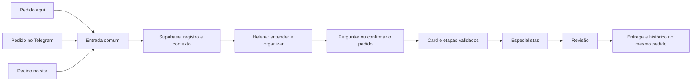

# Pedido único pelo Codex, site e Telegram

Contrato e estado de implementação de 17/10/2026, atualizado após conexão autorizada ao Supabase. O projeto oficial foi confirmado `ACTIVE_HEALTHY`; o checkpoint `CP-20261017-V037` está ativo, com `CP-20261007-V036` preservado no histórico. As migrations 0020 a 0023 estão aplicadas e verificadas no banco; site/Lovable e VPS não foram alterados nesta rodada. Receber ou parear não comprova que o bot, esta conversa ou o motor estejam conectados.

## Estado das peças

- Migration `0021_pedido_entrada.sql`: recepção, leitura e listagem restritas ao fundador autenticado, sem criar card ou job; aplicada e verificada em produção.
- Migration `0022_pareamento_telegram.sql`: código temporário de uso único, consulta/revogação do vínculo e ingresso do bot sob RPC restrita; aplicada e verificada em produção. Nenhum vínculo foi criado no smoke com `ROLLBACK`.
- Migration `0023_pedido_card_v2.sql`: plano confirmado vinculado ao pedido e conversão idempotente em card, sem fabricar tarefa v1. Aplicada no Supabase; verificações de RLS/ACL passaram antes e depois. O smoke `consumo_integral` criou um card a partir de plano sintético e conferiu fontes e repetição sem duplicação, tudo em transação revertida, sem executar agentes.
- Site no checkout: texto livre, recibo, recuperação idempotente, histórico por acompanhamento, Kanban de cards e UI de pareamento. A UI só mostra Telegram vinculado se a consulta ao banco o confirmar; código de pareamento não é guardado no navegador nem incluído no link do bot. Estados `RECEBIDO`, `PLANO_CONFIRMADO` e `CARD_CRIADO` têm textos distintos; só um `card_id` válido abre o Kanban.
- Reenvios do mesmo evento são idempotentes; texto ou acompanhamento divergente com a mesma chave gera conflito. Um novo evento com o mesmo acompanhamento é continuação explícita.
- A origem SITE/CODEX/TELEGRAM é metadado declarado pelo ingresso autorizado, **não prova de entrega operacional**. O banco oferece pareamento, mas não há vínculo ativo nem transporte Telegram/Codex homologado. O bot e esta conversa ainda não enviam pedidos à v2.
- O broker Edge passou 14 testes e o helper 9 testes locais, mas **não foi ativado**: sua capacidade poderia ser acessada pelo modelo ou ferramentas sob o mesmo UID. O desenho recomendado, ainda em rascunho, usa webhook direto à Edge, inbox durável para todos os updates e trabalhador Hermes restrito; o protótipo só de texto e o poller não estão prontos para a troca do bot. Falta acesso à VPS.
- Triagem pela IA, esclarecimentos, proposta estruturada e confirmação na interface continuam pendentes. Recebimento e plano confirmado não são execução concluída; `CARD_CRIADO` também não significa `PRONTO` nem publicação.

No Supabase verificado havia 39 tabelas `helena_v2` e zero pedidos, planos, cards e vínculos duráveis após smokes com `ROLLBACK`. Localmente, a 0023 passou 22 testes SQL e 2 do motor; o instalador passou 5 testes PostgreSQL para 0001–0023 e 2 cenários de upgrade do card v1. A suíte frontend mais recente passou com 244 testes em 20 arquivos; TypeScript e build passaram após as últimas mudanças. Esses testes não comprovam o site publicado nem o bot operante.

## Experiência desejada do fundador

1. Você faz um pedido de trabalho em qualquer canal.
2. Recebe um número de acompanhamento; hoje ele aparece no histórico de pedidos. O Kanban só mostra o card após a conversão confirmada.
3. Helena consulta o contexto vigente do Supabase e propõe empresa, serviço, resultado e etapas. Fatos têm fonte e versão; informação ausente vira uma pergunta.
4. O código confere serviço, permissões, insumos, orçamento e revisores obrigatórios. Você confere a leitura de volta antes da execução.
5. O pedido fica ligado a um único card executável. Agentes trabalham, outro agente revisa, e a entrega volta ao mesmo acompanhamento.
6. Enviar, publicar ou pagar continuam sujeitos às autorizações próprias dessas ações.

## O que o código atual permite

- Supabase Auth e `app_access` identificam o fundador. O login OpenAI do Hermes não substitui essa identidade.
- A v2 já possui estados do card, etapas, revisores, confirmação do fundador, histórico, controle de versão e ações externas separadas.
- O motor aceita uma tarefa capturada de `public.tarefas` com plano pronto; a 0023 aplicada também aceita a conversão nativa de pedido com plano confirmado. Este último caminho só passou em smoke sintético com `ROLLBACK`; a UI ainda não prepara nem confirma automaticamente a proposta estruturada.
- O card `RASCUNHO` já precisa de roteiro e etapas. Criar um card vazio para uma frase ainda não entendida mudaria a máquina e poderia acionar relógio e despacho indevidamente.
- A tela local agora tem Kanban e preserva detalhes, entregas, perguntas e decisões. Publicação real ainda não conferida.

## Menor implementação completa a preparar

**Entrada persistida antes da execução.** A migration 0021 cria o pedido de triagem e RPCs autenticadas. O pedido recebe `pedido_id` e `request_id`; a interface mostra o recebimento, separado do trabalho planejado. A 0023 atribui `card_id` único somente após plano confirmado e consumo pelo motor. O fluxo de proposta e confirmação pela UI ainda falta. Não fabricar tarefa da v1 nem chamar a função antiga de criação a partir do bot.

**Proposta tipada da Helena.** A IA propõe tipo de mensagem, empresa, serviço, objetivo, prazo, fontes e ambiguidades. O código confere os identificadores da revisão vigente e monta as etapas previstas na configuração. Serviços de texto que exigem Parecer conservam esse requisito. Uma proposta incompleta permanece aguardando esclarecimento; não se transforma silenciosamente em ordem de execução.

**Contexto compartilhado.** Ler o checkpoint vigente, decisões, configuração e pedidos relacionados com permissões e limites de empresa. Guardar referências, versão e o que foi confirmado. Não prometer entendimento de toda informação sem consultá-la nem usar um documento antigo como estado atual.

**Identidade nos dois canais.** A 0022 aplicada permite gerar no site autenticado um código temporário e consultar ou revogar o vínculo usuário/chat do fundador. Nenhum chat foi pareado. A integração desta conversa ainda precisa de capacidade restrita de entrada ou sessão autorizada. O broker Telegram não pode ser ativado enquanto a capacidade puder ser alcançada pelo modelo ou ferramentas com o mesmo UID; exige transporte de identidade separada e acesso à VPS. Bot e modelo não recebem a chave administrativa do Supabase.

**Repetição e continuação.** Uma chave do evento impede duplicar reenvios do mesmo canal. Um `request_id` compartilhado no recibo permite continuar o mesmo pedido no outro canal. Reutilizar a chave com conteúdo diferente deve produzir conflito. Duas frases independentes ou paráfrases sem identificador não podem ser consideradas a mesma ordem com certeza: Helena sinaliza possível duplicação e pergunta.

**Kanban fiel ao estado.** Mostrar triagem, preparação, aguardando fundador, em trabalho, pronto e encerrado. Manter estado e motivo exatos no detalhe. Uma espera de etapa ou ação externa aparece como aviso; `PRONTO` não significa publicado.

## Aceite local antes de implantar

- Pedido autenticado gera recibo e registro; anônimo ou canal não pareado é recusado.
- Reenvio com mesma chave retorna o mesmo pedido; conteúdo divergente falha; os dois canais continuam o mesmo identificador.
- Pedido ambíguo gera pergunta e nenhum efeito externo.
- Proposta sem serviço autorizado, fonte necessária ou Parecer obrigatório não avança.
- Conversão confirmada cria um único card com revisão fixada e histórico de origem.
- A tela acompanha o mesmo pedido e a entrega; as permissões continuam valendo.

O checkpoint `CP-20261017-V037` foi sincronizado e está ativo; os registros 1, 14 e 21 do Estado Mestre foram corrigidos com controle de concorrência e o registro 22 documenta a entrada Helena v2. Antes de ativar os componentes restantes, conferir revisão e serviços reais, concluir a proposta estruturada e isolar o transporte Telegram. A autorização para os ajustes já foi concedida; ela não supre o acesso à VPS. O primeiro card real e a prova de 48 horas dependem também dos bloqueios registrados em [onde estamos](onde-estamos.md).
